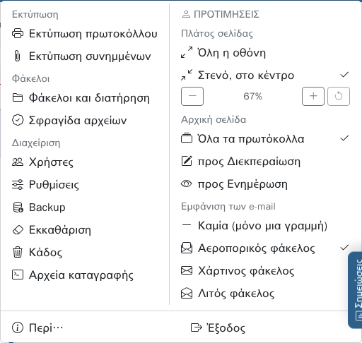
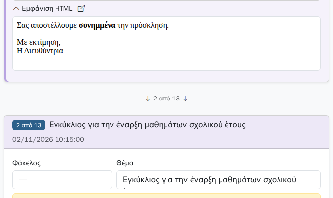

# R5q: the inbox's look, each user's own, with «Καμία»

| | |
|---|---|
| Status | ✅ Done |
| Branch | `task/R5q-envelope-per-user` |

## What was asked (owner, 2026-11-25)
The envelope around each e-mail of the inbox (*Εμφάνιση των e-mail*, one setting for everyone since R5p) should be a
preference of each user, set from the user menu, with a **None** option that shows the separator as it was before.

## What changed
- **Your name → Προτιμήσεις → *Εμφάνιση των e-mail*** (under *Αρχική σελίδα*, for users who have *Εισερχόμενα*):
  - **Καμία (μόνο μια γραμμή)**: no envelope; between two e-mails the thin line with «↓ N από M ↓» of R5o;
  - **Αεροπορικός φάκελος**, **Χάρτινος φάκελος**, **Λιτός φάκελος**: the three envelopes of R5p.

  The ✓ shows the user's look. The inbox changes **at once**, without reloading. The choice is saved with the account,
  like the page width.
- *Ρυθμίσεις → E-mail → Εμφάνιση των e-mail (αρχική επιλογή)* stays, now with *Καμία* too: it is the look of users
  who have not chosen (air mail if it is empty, as before).
- This closes question 5 of Batch 9.6 (A, B or C): each user picks their own.

## Found on the way
Switching the look while the inbox was open lost an e-mail from the page: Livewire, updating the page in place, mixed
the old envelopes with the new ones, and the third e-mail of three disappeared until a reload. The list is now redrawn
whole when the look changes. The browser test found it, and checks it.

## How verified
- PHPUnit `InboxTest::test_each_user_chooses_the_look_and_none_is_the_line`:
  - a user who has not chosen gets the setting;
  - «none» gives no envelopes, one line between the two e-mails («2 από 8»), and two plain wrappers;
  - another user keeps the default; «plain» works; an unknown look is refused;
  - clearing the choice brings the setting back;
  - «Καμία» works as the setting too;
  - a change made with the inbox open redraws it;
  - the menu lists the four looks with the user's pressed; a reader (no inbox) has no such menu.

  `test_the_envelope_look_follows_the_setting` (R5p) still passes. Full suite: 676 tests, green.
- Browser (`inbox-envelopes.spec.js`, invented e-mails only):
  - the menu shows *Εμφάνιση των e-mail*;
  - *Καμία*: at once, no envelope, every e-mail of the page still there, one line between each two;
  - kept after a reload;
  - *Χάρτινος*: envelopes on every e-mail, no line;
  - the choice is removed at the end.

  The R5p test of the three looks still passes.

## Owner actions
None. To try it: step 76 in [OWNER-TODO.md](../../OWNER-TODO.md).
