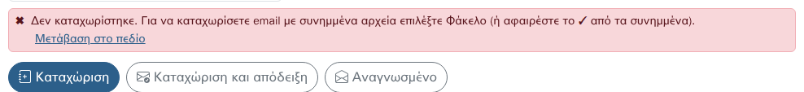
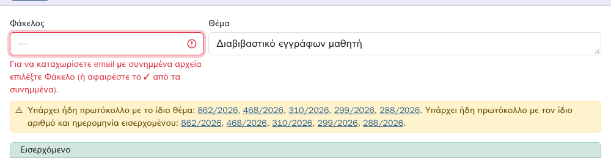

# R5r: a refused «Καταχώριση» in the inbox is seen

| | |
|---|---|
| Status | ✅ Done |
| Branch | `task/R5r-register-error-visible` |

## What was asked (owner, 2026-11-25)
In the inbox, *Καταχώριση* without a *Φάκελος* shows that the app tries to save the e-mail, then stops with *Για να
καταχωρίσετε email με συνημμένα αρχεία επιλέξτε Φάκελο…*. Sometimes that message is not visible, and there is no
sign of what happened. Scroll to the error, or at least do not show the spinning circle, which looks like the save
is going ahead.

## What was wrong
- The message is written under *Φάκελος*, at the **top** of the e-mail's form, while *Καταχώριση* is at the
  **bottom**, below the files. With the files in view, the message was off the screen and nothing near the button
  changed.
- On every press, the notice *Καταχωρίζεται… αποθηκεύονται και τα συνημμένα* and the spinner on the button appeared
  at once. A refusal comes back in a fraction of a second, so it looked like a save that stopped for no reason.

## What changed
- **Refused → the reason comes into view:** the page scrolls to the first field marked wrong (here *Φάκελος*) and puts
  the cursor in it. If that field is hidden (e.g. in the folded *Εξερχόμενο*) or the error has no field, the page
  scrolls to the message below instead.
- **Said next to the button too:** right above the buttons, in red: **Δεν καταχωρίστηκε.** and the reason, with
  *Μετάβαση στο πεδίο* (back to the field). It goes away when the e-mail is registered.
- **No «saving» for a quick refusal:** the notice *Καταχωρίζεται…* and the spinners appear only if the request takes
  longer than half a second, which a real save (with its files) does. The buttons are still disabled at once, so
  there is no double press.
- The same for every refusal: a missing field, a wrong date, the receipt's e-mail address. *Υπάρχει ήδη πρωτόκολλο που
  μοιάζει* keeps its own yellow box with *Ναι, καταχώριση*.

## Found on the way
Livewire hides «while loading» elements before the first request only for the attribute spellings it knows. The
delayed notice was at first shown permanently; it is now hidden until the first press (a browser test checks it).

## How verified
- PHPUnit `InboxTest::test_a_refused_registration_says_why_above_the_buttons`:
  - without a folder: the error at the field, the event to the browser, and the message above the buttons (before
    *Καταχώριση*), only for that e-mail;
  - the notice and the spinners are delayed;
  - fixed and registered: no message, no event.

  Full suite: 678 tests, green.
- Browser (`email-registration.spec.js`, R5c's test extended), in a 500 px high window with *Φάκελος* out of view:
  - *Καταχώριση* → *Φάκελος* comes into view with the cursor in it;
  - «Δεν καταχωρίστηκε.» above the buttons, and «Καταχωρίζεται…» not shown;
  - *Μετάβαση στο πεδίο* brings the field back;
  - with a folder chosen it registers.

  All 27 tests of the inbox and registration files pass, including R5k's «Καταχωρίζεται…» during a real save.

## Owner actions
None. To try it: step 79 in [OWNER-TODO.md](../../OWNER-TODO.md).
