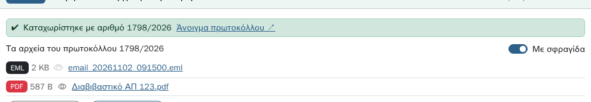

# R5t: the stamp on an e-mail's files after registering, not before

| | |
|---|---|
| Status | ✅ Done |
| Branch | `task/R5t-inbox-preview-after-save` |

## What was asked (owner, 2026-11-25)
Turning the stamp on while previewing a file in the inbox makes no sense before the e-mail is registered: it has no
protocol number yet. Preview the attachments **after** registering, and offer the stamp there.

## What changed
- **Before registering:** an e-mail's attachments open in the preview window **without** *Με σφραγίδα*. They were
  never stamped anyway, so the switch did nothing there.
- **After registering:** under *Καταχωρίστηκε με αριθμό …* the e-mail now lists **the protocol's files** (the
  attachments it saved and the e-mail itself), each with its 👁. *Με σφραγίδα* sits at the top of the list. A PDF
  opens with the stamp (number, date), to look at or print, and ‹ › go through these files. A file without a preview
  gets the grey 👁 (R4j).
- In the preview window, *Με σφραγίδα* is shown only for files that can be stamped: a protocol's PDF, docx or odt
  without the stamp already inside. For pictures, text and spreadsheets it is hidden; it had no effect on them.
- If the protocol has been moved to the trash since, the list is not shown (its files are in the trash too).

## How verified
- PHPUnit `InboxTest::test_files_are_stamped_only_after_registering`:
  - before registering: no «stampable» file and no list;
  - after registering: the list with the protocol's number, its switch, the PDF's 👁 (download address, group, can
    be stamped), and every file of the protocol;
  - moved to the trash: no list.

  `PreviewTest`: in the form the PDF and the docx can be stamped. Full suite: 681 tests, green.
- Browser (`email-registration.spec.js`, R5c's test extended):
  - the e-mail's PDF before registering: the window opens without the switch;
  - registered: the list, the PDF in it, the switch;
  - the PDF's 👁 opens the window with the switch.

  The stamp, preview, inbox and registration browser files pass (27 tests).

## Owner actions
None. To try it: step 82 in [OWNER-TODO.md](../../OWNER-TODO.md).
