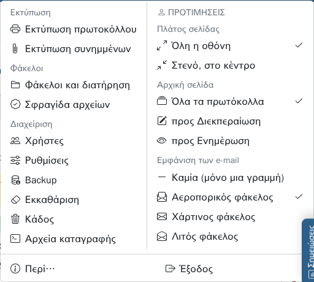
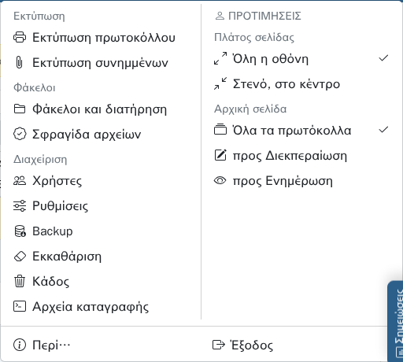

# R5u: «Εμφάνιση των e-mail» only in the inbox's menu

| | |
|---|---|
| Status | ✅ Done |
| Branch | `task/R5u-envelope-choice-on-inbox` |

## What was asked (owner, 2026-11-25)
The inbox's look (R5q) only matters when the user is looking at the inbox: hide it from the menu on the other
screens.

## What changed
- The user menu shows *Εμφάνιση των e-mail* (Καμία / Αεροπορικός / Χάρτινος / Λιτός) **only on *Εισερχόμενα***. On
  every other screen the menu has *Πλάτος σελίδας* and *Αρχική σελίδα* only.
- The choice itself is unchanged: saved per user, applied at once on the inbox.

## How verified
- PHPUnit `InboxTest::test_each_user_chooses_the_look_and_none_is_the_line`: the menu on */inbox* has the four looks
  with the user's pressed; */about*, *Λίστα* and the protocol form have no such choice. Full suite: 682 tests, green.
- Browser (`inbox-envelopes.spec.js`, R5q's test extended): the inbox's menu has the choice; the list's menu does not.
  The choice still applies at once and is kept after a reload.

## Owner actions
None. Step 76 in [OWNER-TODO.md](../../OWNER-TODO.md) now says where to find it.
