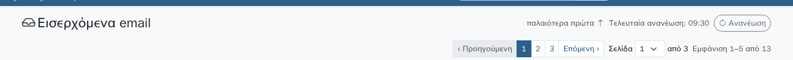
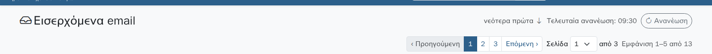

# R5v: inbox: the range once, and the order swapped with a click

| | |
|---|---|
| Status | ✅ Done |
| Branch | `task/R5v-inbox-order` |

## What was asked (owner, 2026-11-26)
«The text *11–20 από 55* appears two times. Remove it from the top. Also, add a small arrow right next to *παλαιότερα
πρώτα* and give the user the ability to change the ordering between *παλαιότερα πρώτα* and *νεότερα πρώτα* (with
relevant arrows).»

## What changed
- **The heading row:**
  - It no longer repeats the range. *Εμφάνιση 11–20 από 55* stays at the pager.
  - With a single page there is no pager, so the heading still says how many e-mails there are (*8 email ·*).
- **The order is a button:**
  - *παλαιότερα πρώτα ↑* (the dates go up);
  - *νεότερα πρώτα ↓* (the dates go down).

  A click swaps the order and goes back to the first page. The tooltip says what a click does (*Αλλαγή σε νεότερα
  πρώτα*).
- **Each user's own choice**, kept like the envelope look (R5q). Until a user chooses, the setting *Σειρά e-mail*
  (Ρυθμίσεις → Εισερχόμενα) decides, as before. It is now the default for each user.

| Παλαιότερα πρώτα ↑ | Νεότερα πρώτα ↓ |
|---|---|
|  |  |

## Also fixed: a browser test that depended on the order
`inbox.spec.js` R5k picked «another e-mail» with a filter that looked only *inside* each e-mail, so it never left the
one being registered out. It failed whenever that e-mail was first on its page, which depends on the order. It now
uses `:not(#id)`. What it checks is unchanged.

## How verified
- PHPUnit `InboxTest::test_each_user_swaps_the_order_and_the_range_is_shown_once`:
  - page 2: the heading has no range, but has the total and *παλαιότερα πρώτα ↑*; the pager has *Εμφάνιση 4–6 από
    8*;
  - the swap: first page, newest first (8, 7, 6), *↓*, the user's preference stored; swapped back;
  - another user still follows the setting;
  - with the setting changed, the user's own choice wins.

  Inbox tests: 46, green.
- Browser (`inbox.spec.js`, R5v): no range in the heading; the order's text and arrow; click → the other order and
  arrow; kept after a reload; swapped back. R5k and the whole inbox and smoke specs pass.

## Owner actions
None. To try it: step 101 in [OWNER-TODO.md](../../OWNER-TODO.md).
