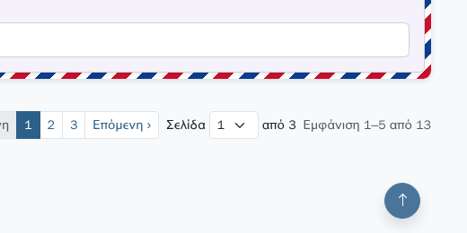

# R5w: «back to the top» on the inbox page too

| | |
|---|---|
| Status | ✅ Done |
| Branch | `task/R5w-inbox-scroll-top` |

## What was asked (owner, 2026-11-26)
«Please add the "back to top" icon-button we already have in the main screen to the inbox screen too.»

## What changed
- **The button:** the inbox page has the round **↑** of the list (R2m). It sits at the bottom right, left of the
  notepad's strip on wide screens, and takes you back to the top (smoothly, unless the system asks for less motion).
- **One copy for both pages:** the button is now a shared piece (`partials/scroll-top`), used by the list and the
  inbox.
- **Nothing covered:** the inbox has the same room at its end as the list, so at the very bottom the button covers no
  button and not the lower pager.

## How verified
- PHPUnit:
  - `InboxTest::test_the_inbox_has_the_back_to_top_button`;
  - `ProtocolListTest`, for the list's button, unchanged and green.
- Browser (`inbox.spec.js`, R5w): scrolled to the end, the ↑ is in view at the bottom right and over no button or
  pager; a click goes back to the top.

## Owner actions
None. To try it: step 104 in [OWNER-TODO.md](../../OWNER-TODO.md).
