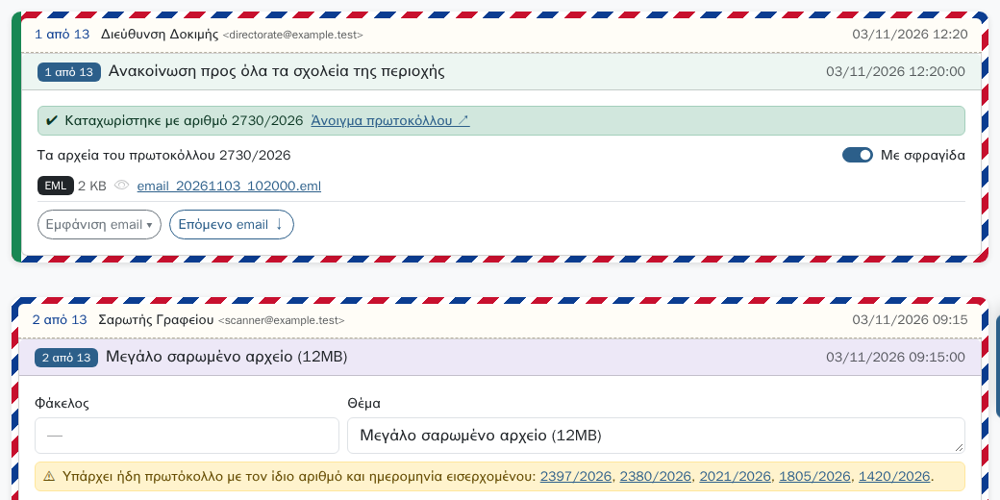
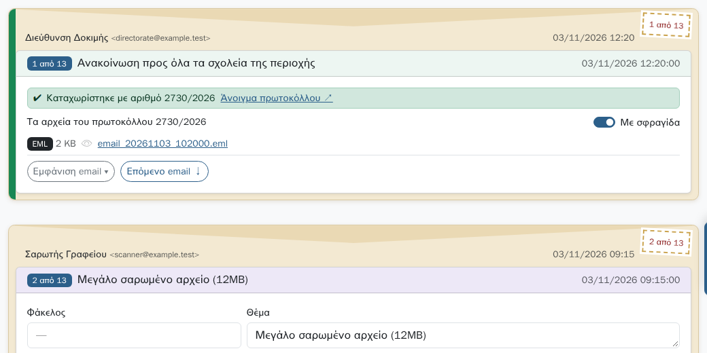
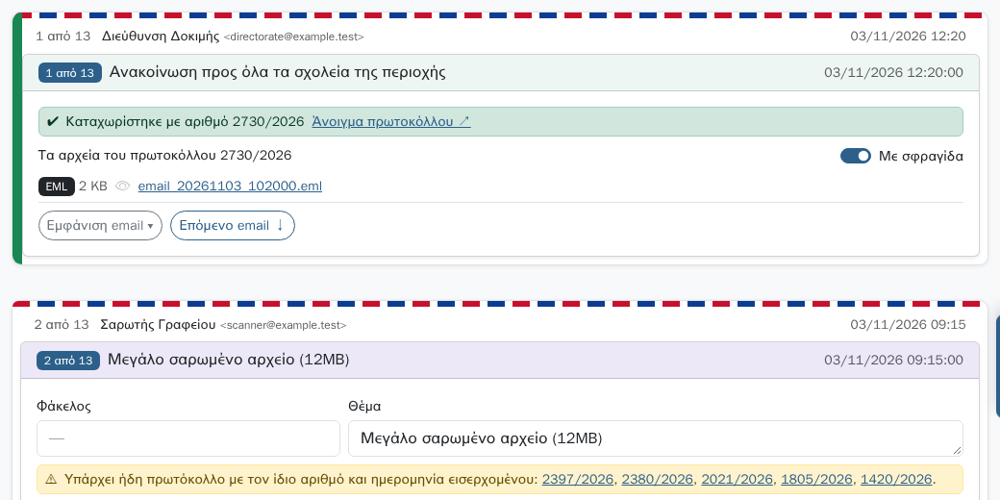
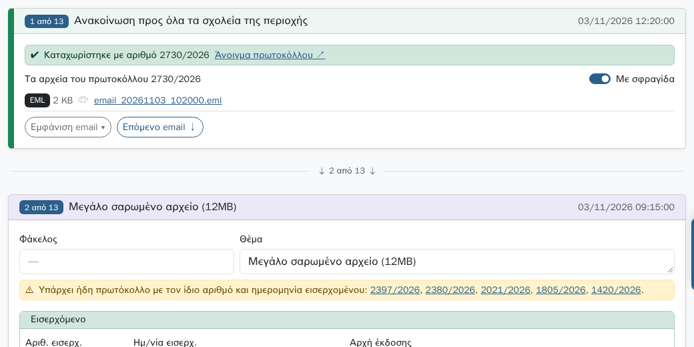

# R5x: a registered e-mail is marked green in the inbox

| | |
|---|---|
| Status | ✅ Done |
| Branch | `task/R5x-inbox-saved-green` |

## What was asked (owner, 2026-11-26)
«In the inbox page, whenever an email gets saved successfully mark the whole virtual folder (email) with green so as it
is visually separated from an un-saved/new email. If you deem it more useful from a UX perspective, paint a green banner
at the left of the envelope.»

## What changed
- **A green stripe down the left of the envelope** once the e-mail is registered (any number, also «already
  registered»). The new e-mails and those moved to *Αναγνωσμένο* (no protocol, nothing saved) have none.
- **Why a stripe and not a green envelope:** each user chooses the envelope's look (air mail, paper, plain, none;
  R5q). Painting the whole envelope green would hide the look they chose, and would read like the form's green
  *Εισερχόμενο* section. A stripe works the same on every look and is still seen while scrolling past a long e-mail.
  The registered e-mail's header is already light green, with «Καταχωρίστηκε με αριθμό …» under it.
- **In every look:** the stripe sits in the envelope's own margin (air mail, paper, plain), so nothing inside moves under
  it; with *Καμία* (no envelope) it is the card's left border.

| Air mail | Paper |
|---|---|
|  |  |
| **Plain** | **None** |
|  |  |

## How verified
- PHPUnit: `InboxTest::test_a_registered_email_is_marked_in_any_look`: nothing is marked before; after registering
  e-mail 1 and marking e-mail 2 read, only e-mail 1 is marked, in the air-mail look and in «none». The whole
  `InboxTest` is green (48 tests).
- Browser (`inbox-envelopes.spec.js`, R5x): an e-mail is registered, then the look is switched from the user menu
  (air mail → paper → plain → none, without reloading). Each time the registered envelope has the green stripe (the
  Bootstrap success colour, wider than 6 px), the next e-mail has none, and a screenshot is taken.

## Owner actions
None. To try it: step 109 in [OWNER-TODO.md](../../OWNER-TODO.md).
