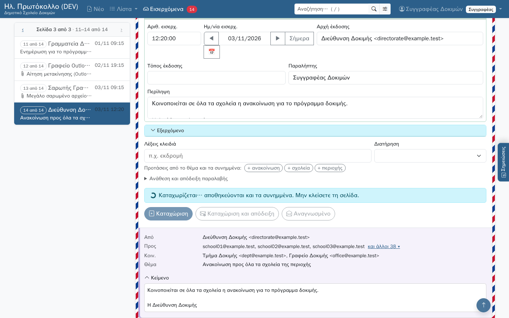
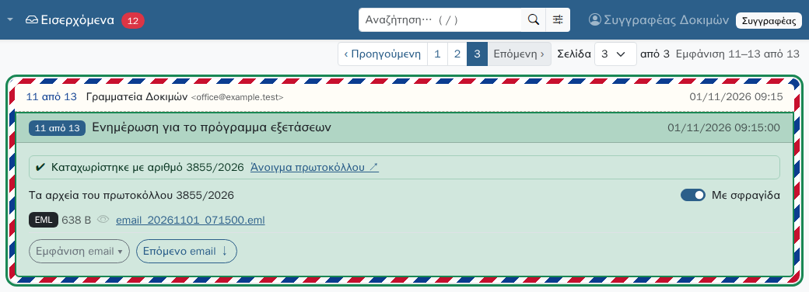
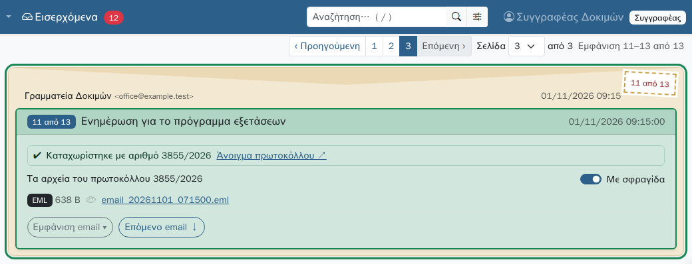
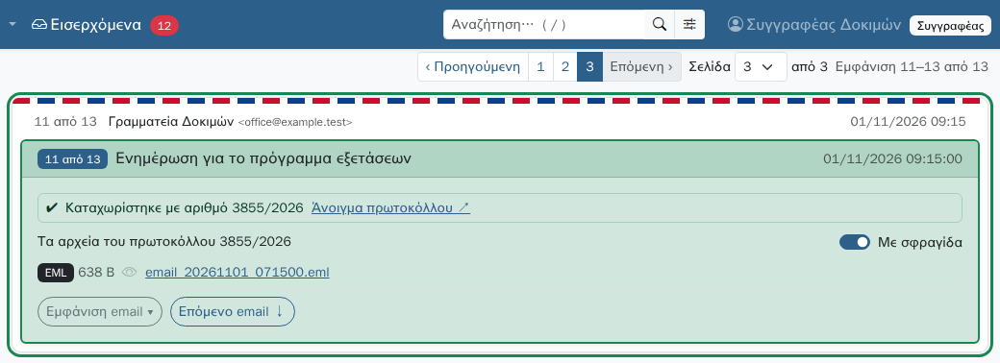
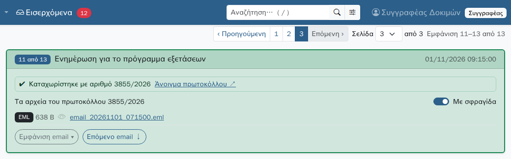
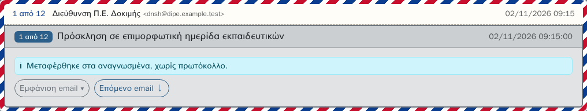

# R5y: inbox: one spinner while registering; a saved e-mail tinted and followed

| | |
|---|---|
| Status | ✅ Done |
| Branch | `task/R5y-inbox-saved-tint` |

## What was asked (owner, 2026-11-27)
- «When clicking Καταχώρηση there are two separate loading circles. Keep the one right next to the text, remove the one
  from the button, but keep the button disabled while it is saving.»
- «The green band on the left does not satisfy me. Give a green tint on the whole envelope of that e-mail and make the
  whole border green (themed if possible). Likewise a grey tint for Αναγνωσμένα.»
- «When saving completes, the section shrinks instantly and my eyes have to hunt for where it moved. Scroll to the
  shrunk section just after it shrinks.»

## What changed
- **One spinner.** It is the one in the blue notice «Καταχωρίζεται… αποθηκεύονται και τα συνημμένα». The buttons
  *Καταχώριση*, *Καταχώριση και απόδειξη* and *Ναι, καταχώριση* keep their icon and are only disabled (greyed) while it
  runs, as before.
- **Registered: green.**
  - The whole e-mail is tinted light green, with a green border all round.
  - In the envelope looks, a green line also goes round the envelope; each look keeps its own pattern inside.
  - This replaces R5x's stripe on the left.
- **Moved to «Αναγνωσμένα»: the same in grey.**
- The colours are Bootstrap's theme colours (`success` / `secondary` and their light shades), so a dark theme would get
  its own.
- **The page follows the e-mail.** When it is registered or moved to *Αναγνωσμένα*, its form goes and it becomes much
  shorter. The page then scrolls (smoothly, or at once with reduced motion) so that its top is just below the top bar.

| Look | Registered |
|---|---|
| Αεροπορικό |  |
| Χάρτινο |  |
| Απλό |  |
| Καμία |  |

Moved to *Αναγνωσμένα*:

## How verified
- PHPUnit `InboxTest`:
  - `test_a_registered_email_is_marked_in_any_look`:
    - `is-saved` on the registered one and `is-read` on the read one, in the airmail look and in «Καμία»;
    - each sends `inbox-done` with its number.
  - `test_a_refused_registration_says_why_above_the_buttons`: the form has exactly one spinner (in the notice); the
    button has only its icon and is disabled during register / markRead.
  - `test_similar_protocol_is_shown_and_needs_a_second_click`: *Ναι, καταχώριση* has no spinner and is disabled.

  Full suite green.
- Browser (`inbox.spec.js`):
  - **R5k**: while saving, the notice's spinner is shown, the pressed button has none and is disabled; the same for
    *Ναι, καταχώριση*.
  - **R5x / R5y**:
    - registered from a low window with the buttons at its bottom (the e-mail's top out of view);
    - the envelope's top then ends just below the top bar. Without the new code it stayed 525 px above the window;
    - in all four looks: the card's border green on all four sides, the green tint, and the green line round the
      envelope.
  - **R5l**: *Αναγνωσμένο*: `is-read`, grey border and tint, in view.

## Owner actions
None. To try it: step 111 in [OWNER-TODO.md](../../OWNER-TODO.md).
