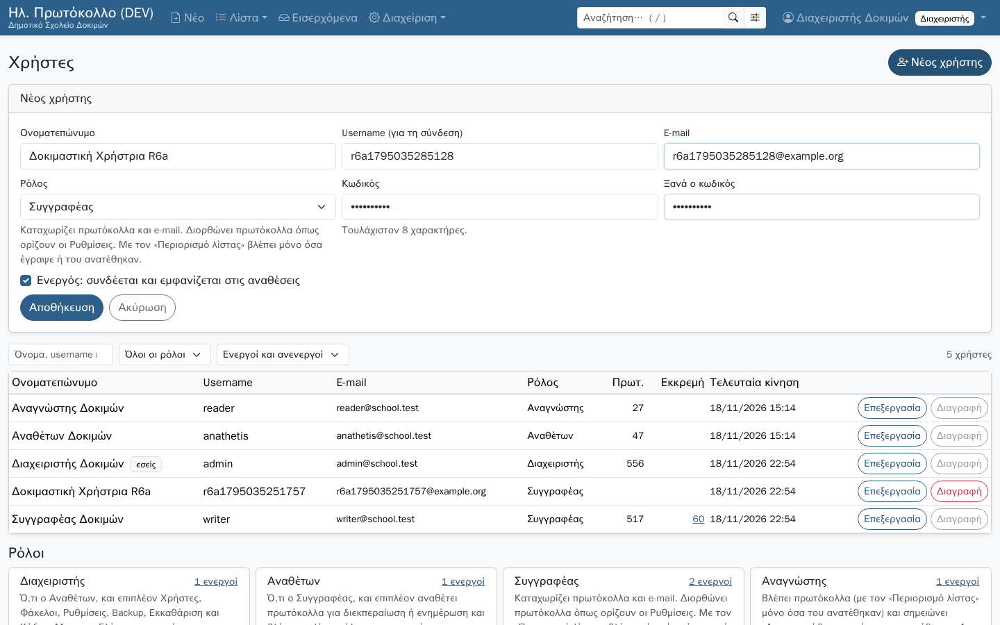
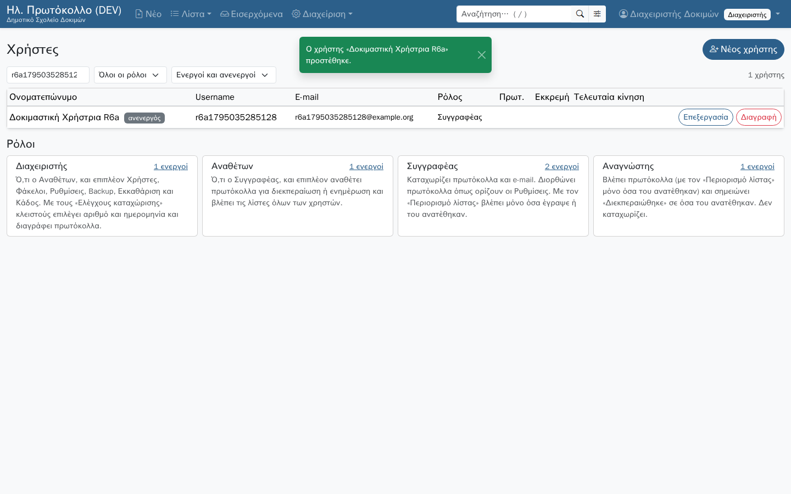
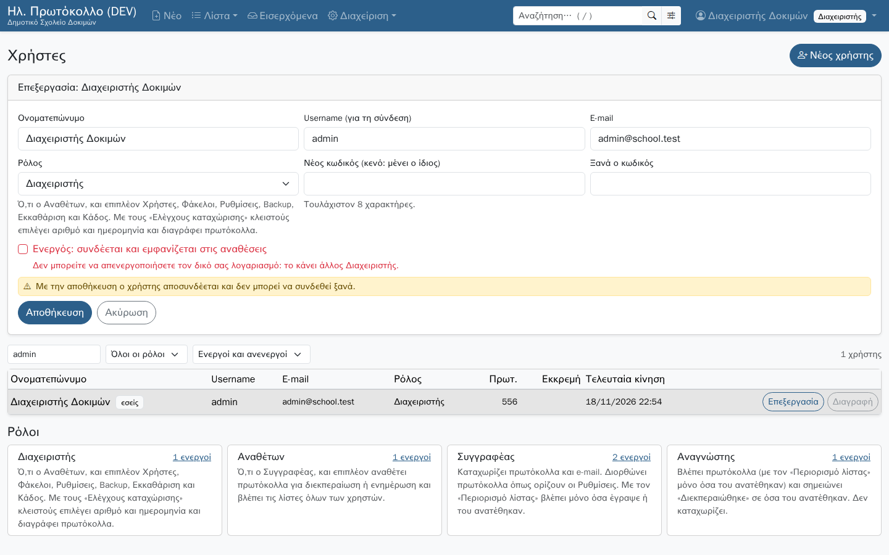

# R6a: users and roles

| | |
|---|---|
| Status | ✅ Done |
| Branch | `task/R6a-users` |

## What was asked (BACKLOG R6a)
"Users & roles screens; registration only for first admin (S00 kept)."

## What was wrong
- **An inactive user could still log in.** *Ενεργός* only hid the user from the assignment lists; the login form never
  checked it, and a user who was logged in stayed logged in.
- The **last administrator could be deleted**. That reopened self-registration (the old code then deleted the
  registration marker), so anyone reaching the server could make themselves administrator.
- A user could be **deleted by a plain link** (`GET /users/del/{id}`), without a CSRF check. A page elsewhere could
  delete a user through the browser of a logged-in administrator.
- Deleting a user who had registered protocols or had assignments left those protocols without a name.
- An administrator could deactivate or demote themselves and lose access.
- The role was **silently not saved** in some cases: with one administrator, editing that administrator ignored a
  role change without saying so.
- A password change did not log the user out of other computers.

## What changed
- `/users` is the new page **Χρήστες** (Livewire `App\Livewire\UserAdmin`, administrators only). It replaces the old
  form-in-a-table.
  - **Table:** name, username, e-mail, role, protocols registered, open assignments (a link to their list) and last
    activity. Inactive users are greyed and listed last; your own account is marked *εσείς*.
  - **Search** by name, username or e-mail, and filters by role and by active/inactive (kept in the address).
  - **Νέος χρήστης / Επεξεργασία** opens one form card above the table. Choosing a role shows **what that role may
    do**. On edit, an empty password keeps the old one. Unticking *Ενεργός* warns that the user will be logged out.
  - `/users/{id}` still opens that user for editing.
  - **Ρόλοι:** four cards with what each role may do and how many active users have it (a click filters the table).
    The roles stay the four fixed ones: the code decides by their names (`App\Support\Roles`).
- Rules, now on the server (`App\Services\Users\UserAccounts`):
  - at least **one active administrator** always remains (no demote, deactivate or delete of the last one);
  - nobody deactivates, demotes or deletes **their own** account here: another administrator does it;
  - a user with **protocols or assignments** cannot be deleted. *Διαγραφή* is disabled, and its tooltip says why
    and suggests deactivating;
  - passwords: **at least 8 characters** (as the first administrator's registration; the old page asked for 6), and
    typed twice;
  - username: unique and without spaces.
- **Inactive means no login:**
  - the login form refuses inactive accounts, with the usual "wrong details" message;
  - a user deactivated while logged in is logged out on the next click (`App\Http\Middleware\EnsureActiveUser`);
  - deactivating or changing a password ends the user's open sessions and "remember me".
- Removed: `POST /users`, `POST /users/{id}`, `GET /users/del/{id}` (saving and deleting are actions of the page).
  Registration (S00) is unchanged: open only while no active administrator exists.

## How it was verified
- PHPUnit `tests/Feature/UserAdminTest.php` (13 tests):
  - only administrators open the page; the old write routes are gone;
  - add, edit with empty password, password change (sessions ended);
  - validation (password length/confirmation, unique username without spaces, e-mail, role);
  - last active administrator, own account, users with protocols;
  - an inactive user cannot log in, and a deactivated one is logged out on the next request;
  - search (LIKE wildcards escaped) and filters; non-administrators refused.
- Route snapshot updated: only the three removed routes.
- Browser test `e2e/tests/users.spec.js`:
  - add a writer;
  - they log in in another browser;
  - deactivate them: their next click goes to the login page, and logging in again fails;
  - your own account cannot be deactivated or deleted.
- Full suites: PHPUnit 472 green; browser tests: all of CI.

Screenshots: new user with the role's description, the list after deactivating, refusal on your own account.

## Owner actions
- Before the move to the new version, check on *Χρήστες* that everyone who still works with the protocol is
  **Ενεργός**. Inactive users can no longer log in.
