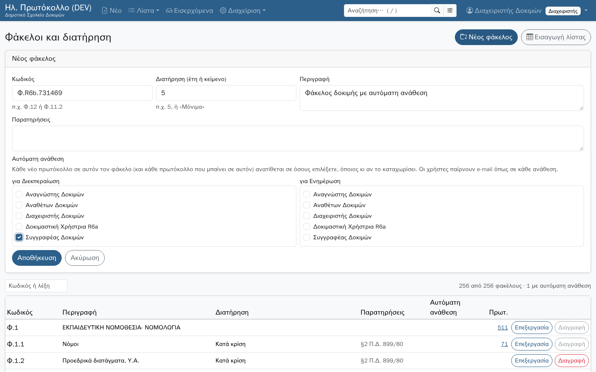
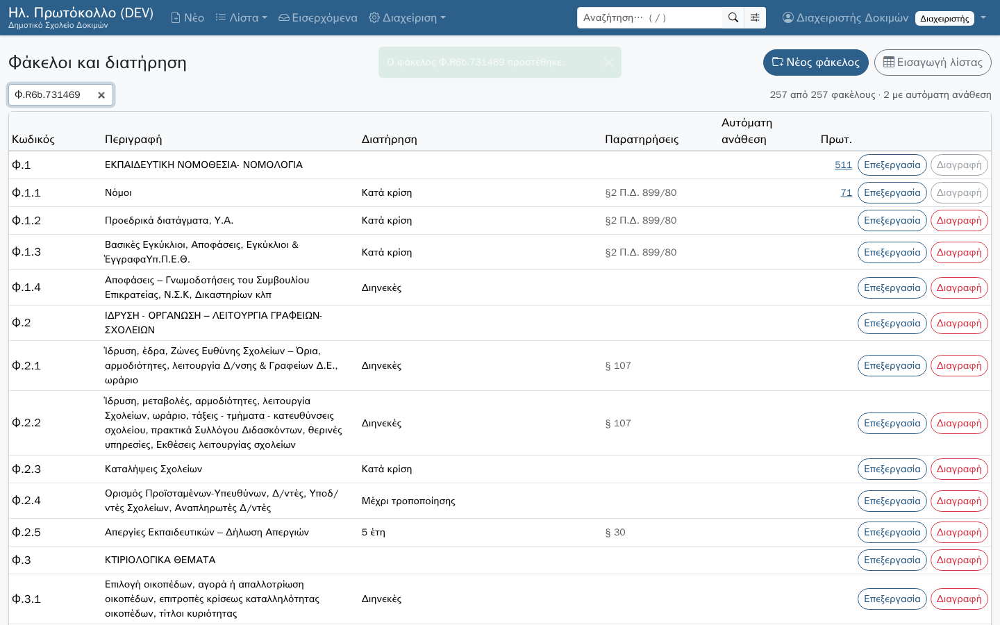
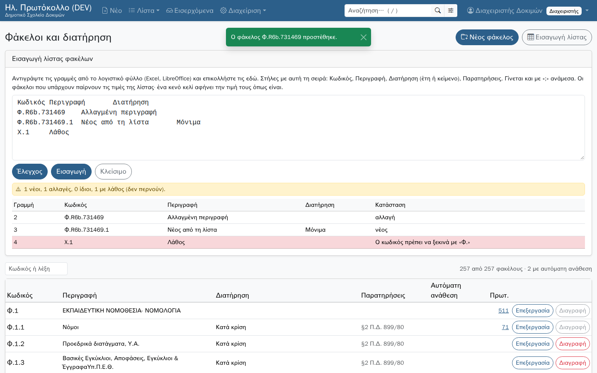

# R6b: folders and automatic assignment

| | |
|---|---|
| Status | ✅ Done |
| Branch | `task/R6b-folders` (on top of R6a) |

## What was asked (BACKLOG R6b)
"Folders (Φ.) screen + auto-assignment rules (folder → d-users / e-users)." The owner also asked for a way to bring in
the full folder list without typing it (OWNER-TODO question 2).

## What was wrong
- A folder was **deleted by a plain link** (`GET /keep/del/{id}`, no CSRF check), even when protocols used it.
- A folder's **code could be renamed while protocols used it**. Protocols store the code as text, so they were left
  with a code that is in no list.
- Every folder had to be typed in one by one.

## What changed
- `/keep` is the new page **Φάκελοι και διατήρηση** (Livewire `App\Livewire\FolderAdmin`; the menu item was
  *Διατήρηση*).
  - **Everybody** sees the folders. Administrators add, change, delete and import them.
  - **Table:** code, description, Διατήρηση, remarks, **automatic assignment** (badges *Δ:* / *Ε:* with names) and
    how many protocols are in the folder (a link to the search with that folder).
  - **Search** by code (the R1h rule: `φ11` finds Φ.11…) or by a word of the description or remarks, without
    accents.
  - **Form card:**
    - code: typed `φ12` / `Φ 12` becomes `Φ.12`;
    - Διατήρηση in **one field**: a number is years (`10` or `10 έτη`), anything else is text such as *Μόνιμα*. It is
      stored as before: `keep` or `keep_alt`;
    - description and remarks: line breaks are kept;
    - **who gets this folder's protocols**: active users, for διεκπεραίωση and for ενημέρωση. A user chosen for
      both is kept only for διεκπεραίωση, which includes being informed.
  - `/keep/{id}` still opens that folder.
- **Rules** (`App\Services\Folders\FolderCatalog`):
  - the code keeps the old page's rule: `Φ.` then a letter or digit;
  - codes are unique;
  - a code **in use** is not renamed or deleted (*Διαγραφή* is disabled, and its tooltip says how many protocols use
    it). The description, Διατήρηση and remarks can always change.
- **Import of a list** (*Εισαγωγή λίστας*):
  - copy the rows from Excel or LibreOffice and paste them. Columns: code, description, Διατήρηση, remarks; `;`
    between the cells works too;
  - a heading row is skipped;
  - *Έλεγχος* shows each row as new / change / same / error (wrong code, same code twice) before anything is written;
  - existing folders take the list's values, and an empty cell keeps the old value;
  - automatic assignments are not touched.
- New table `folder_assignments` (folder, user, `d`/`e`):
  - the folder side has a foreign key (removed with the folder);
  - the user side has none, because `users.id` is INT on 2016 installations and BIGINT on new ones;
  - deleting a user removes their rows.
- R1d applies the rules when protocols are saved.
- Removed: `POST /keep`, `POST /keep/{id}`, `GET /keep/del/{id}`.

## How it was verified
- PHPUnit `tests/Feature/FolderAdminTest.php` (9 tests):
  - roles: who sees and who changes;
  - the old routes are gone;
  - Διατήρηση as years or text;
  - assignments (d wins over e);
  - code rules, codes in use, search;
  - `/keep/{id}`;
  - import (heading, update keeping empty cells, `;`, wrong and duplicate codes, `φ 702` → `Φ.702`);
  - a deleted user's rules are removed.
- `FolderDescriptionTest` (D06) moved to the new page: long text, line breaks kept, escaped, no ` `.
- R3c's "old pages have the search box" test now uses `/print`, still on the old layout.
- Browser `e2e/tests/folders.spec.js`:
  - add a folder with an assignment, find it, import a list (preview, confirm, result);
  - readers see no buttons.
- Full PHPUnit: 481 green.

## Owner actions
- Your folder list (OWNER-TODO question 2): paste it in *Φάκελοι και διατήρηση → Εισαγωγή λίστας*. Copy the rows from
  the spreadsheet with the columns in this order: code, description, Διατήρηση, remarks. Press *Έλεγχος* first to see
  what will change.
