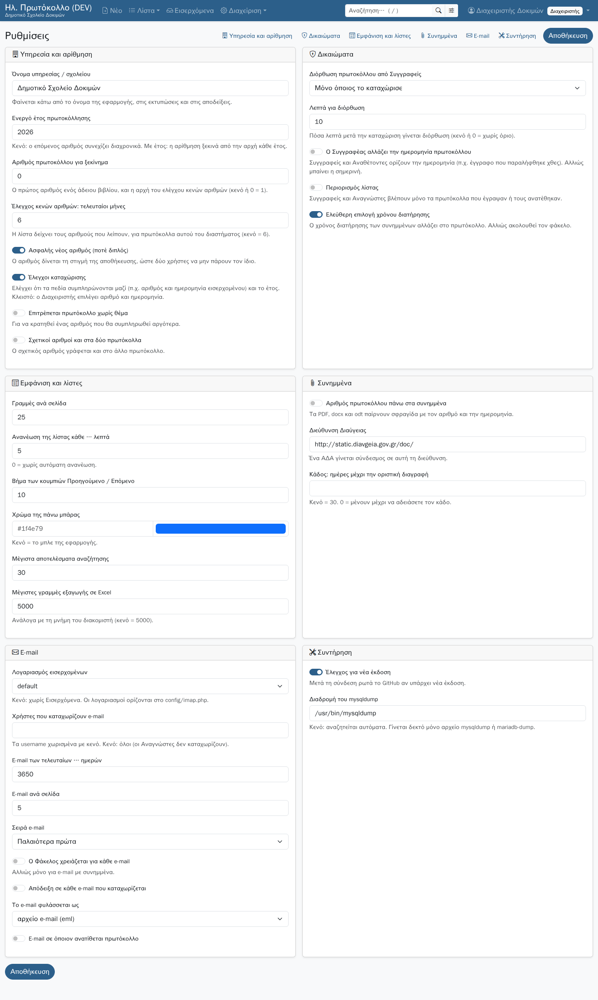
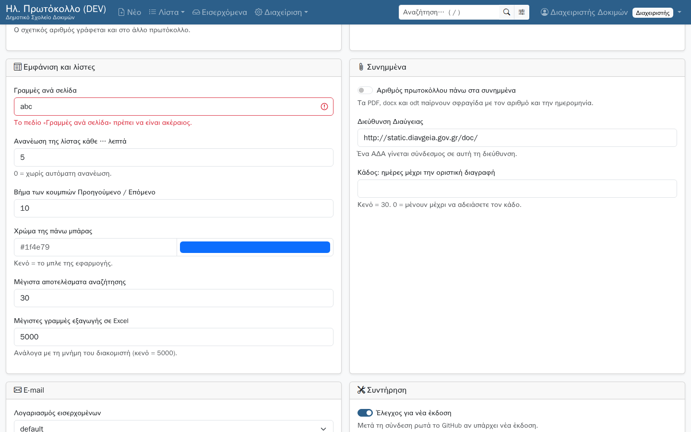
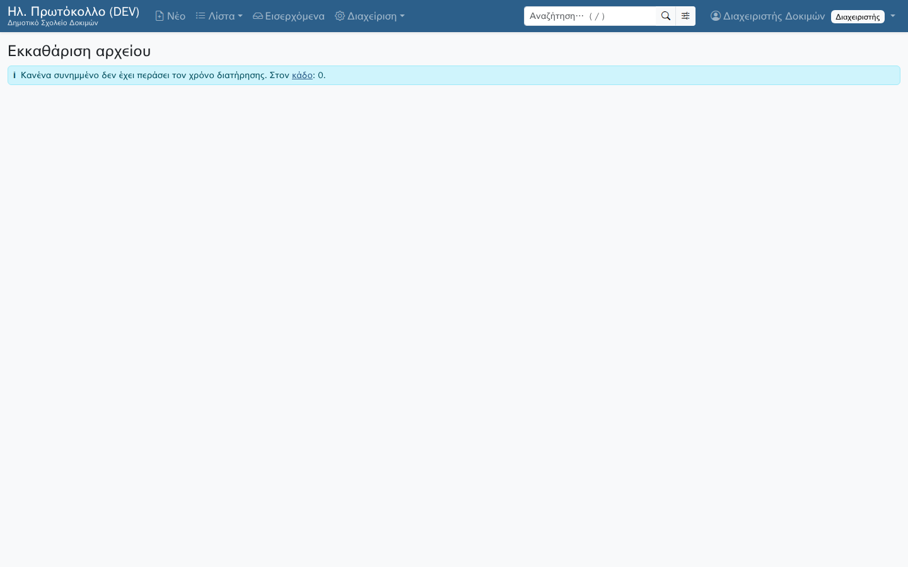
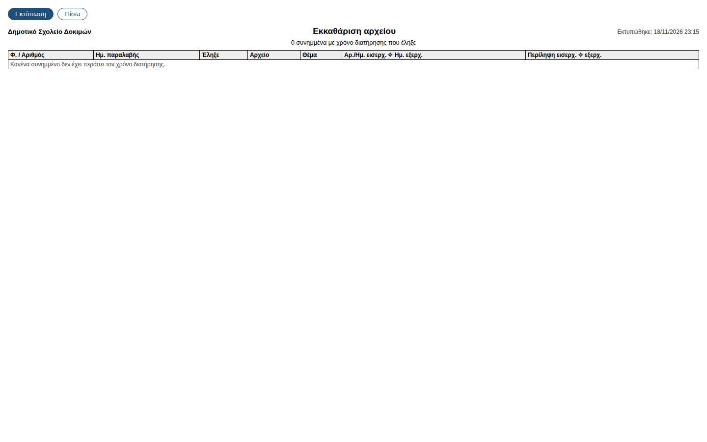
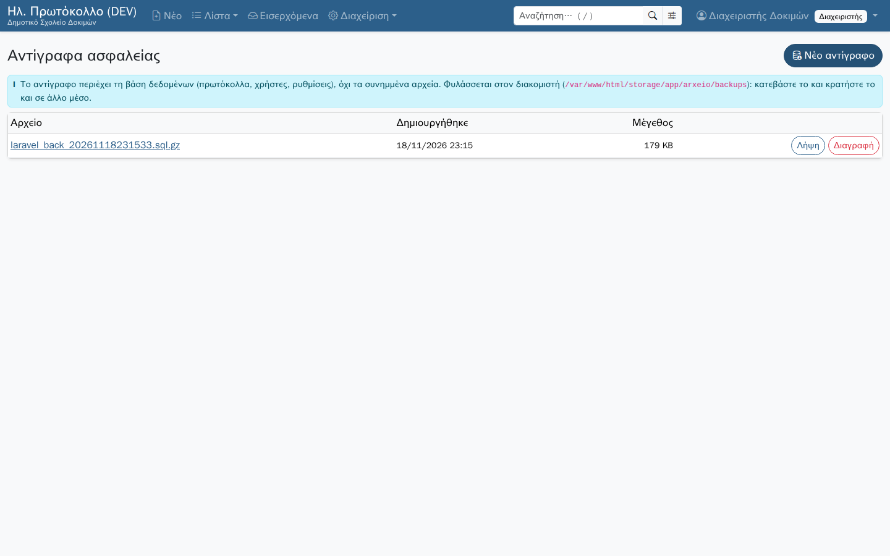

# R6c: settings, backups, clean-up

| | |
|---|---|
| Status | ✅ Done |
| Branch | `task/R6c-settings` (on top of R1d) |

## What was asked (BACKLOG R6c)
"Settings (incl. gap-check and trash-retention settings), backups (🔎 path traversal fix), archive/expired screens."
The path traversal of the backup download/delete was already closed in B10. This task rebuilds the three screens.

## What was wrong
- **Ρυθμίσεις** stored **any posted field** as a setting, and checked only a few of them. Examples:
  - a colour such as `red; background:url(x)`;
  - the year `26`;
  - a link `javascript:…` for Διαύγεια;
  - a `mysqldump` path to another program. It was refused only when the backup ran.
- Changes were made by **plain links** (GET, no CSRF check):
  - creating a backup (`/backup`);
  - deleting a backup (`/deleteBackup/{name}`);
  - moving expired files to the trash (`/delExpired`);
  - emptying the trash (`/delDeleted`).

  A page elsewhere could trigger them through the browser of a logged-in administrator.
- **Εκκαθάριση** showed only counts. Its printed list showed dates as `20200101`, and the print time used the month
  instead of the minutes.
- The list *Χρήστες που καταχωρίζουν e-mail* was checked **as a substring**: a user `nik` passed with `nikos` in the
  list.

## What changed
- **Ρυθμίσεις** (`/settings`, Livewire `App\Livewire\SettingsPage`) is drawn from one list, `App\Support\SettingsCatalog`.
  - Each setting has its group, a label, a short **explanation** and its check.
  - **Six cards:** Υπηρεσία και αρίθμηση, Δικαιώματα, Εμφάνιση και λίστες, Συνημμένα, E-mail, Συντήρηση. Links at
    the top go to each card.
  - **Switches** instead of ΝΑΙ/ΟΧΙ lists. Lists say what they mean: *Διόρθωση πρωτοκόλλου από Συγγραφείς*: Κανένας /
    Μόνο όποιος το καταχώρισε / Όλοι οι Συγγραφείς.
  - A colour field with a colour picker.
  - **A wrong value is shown at its field and nothing is saved.** Only the list's settings are saved. The message
    says how many settings changed.
  - Settings nothing reads any more are removed by a migration and from the installer: `searchField1–3`,
    `showUserInfo`, `allowListValuesMatchingInput`. `wideListProtocol` stays until the old layout goes (Z01).
- **Backup** (`/backups`, `App\Livewire\BackupPage`):
  - *Νέο αντίγραφο* is a button, and shows *Δημιουργία…* while it works;
  - the list shows each copy's date and size;
  - *Λήψη* downloads, and *Διαγραφή* asks first;
  - a note says the copy is the **database only**, not the attachments, and where it is kept.
- **Εκκαθάριση** (`/arxeio`, `App\Livewire\ArchivePage`, service `App\Services\Attachments\Expired`):
  - the expired attachments with folder, protocol (link), subject and expiry date;
  - *Εκτύπωση λίστας* opens a print page;
  - *Μεταφορά στον κάδο* (after a question) moves them all to the trash, with a link to it;
  - emptying the trash is on the trash page (R4b);
  - `/expired/1`, the old "files in the trash" list, now goes to `/trash`.
- **Print layout** `layouts/print` (used again in R7):
  - A4 landscape;
  - the table header repeats on every page, and rows are not split;
  - the institution, the title and *Εκτυπώθηκε* with the time;
  - an *Εκτύπωση* button that is not printed.
- *Χρήστες που καταχωρίζουν e-mail*: **whole usernames**, separated by spaces or commas, case ignored.
- Removed routes: `POST /settings`, `GET /backup`, `GET /deleteBackup/{name}`, `GET /delExpired`, `GET /delDeleted`.

## How it was verified
- PHPUnit `tests/Feature/SettingsPageTest.php` (10 tests):
  - only administrators, also for the page actions;
  - the old routes are gone;
  - every setting in the list is shown and saved, and unknown keys are not;
  - wrong values: nothing saved;
  - `mysqldump` paths for Windows and Linux;
  - turning off the update check;
  - the removal migration;
  - whole usernames for the inbox;
  - expired list, print and move to the trash.
- Moved to the new pages, same checks:
  - `BackupTest`: complete dump, error leaves no file, shell characters, delete only valid names, admins only;
  - `NumberGapsTest` and `TrashTest`: settings validation, clean-up through the trash;
  - `DateColumnsTest` and `AttachmentMetadataTest`: expired files go to the trash and record the administrator.
- Route snapshot: only the five removed routes.
- Browser:
  - `e2e/tests/settings.spec.js`: a wrong value is refused at its field, a right one is saved and kept after a
    reload; the clean-up page and its print;
  - `e2e/tests/backup.spec.js`: create, download (complete dump), no GET delete, delete with the question;
  - the e2e helper `setSetting` uses the new page (protocol form and list tests).
- Full PHPUnit: 498 green.

## Owner actions
- After the update, open *Ρυθμίσεις* once and read the explanations. Nothing changes by itself: every value stays as
  it was.
- *Χρήστες που καταχωρίζουν e-mail*: if you use it, write the usernames whole (e.g. `maria nikos`).
