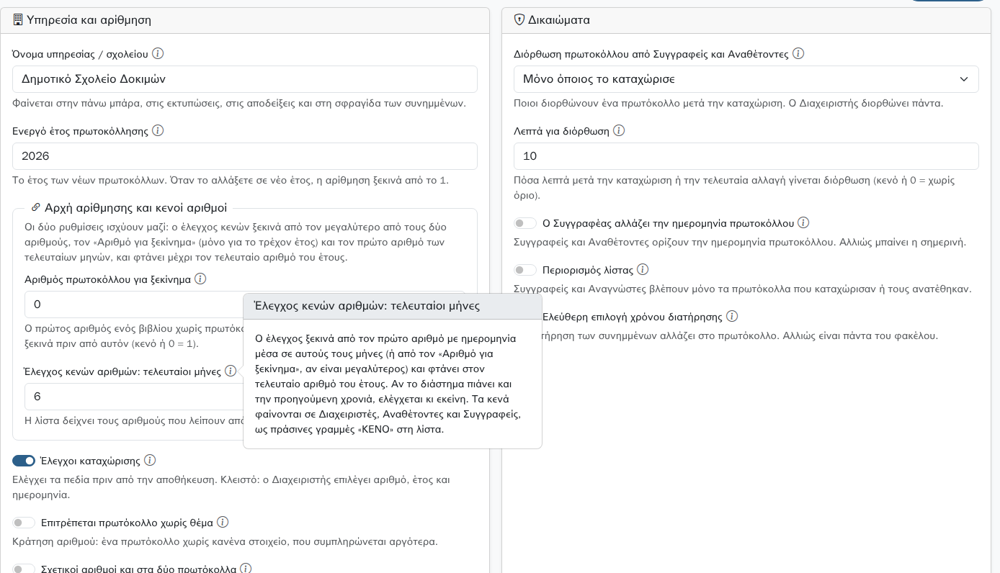

# R6d: every setting explained; numbering settings framed together; settings without effect hidden

| | |
|---|---|
| Status | ✅ Done |
| Branch | `task/R6d-settings-help` |

## What was asked (owner, 2026-11-19)
- Rewrite the help texts of *Αριθμός πρωτοκόλλου για ξεκίνημα* and *Έλεγχος κενών αριθμών: τελευταίοι μήνες*. The
  owner had asked whether the two combine, and how.
- An explanation for **every** setting, maybe as a tooltip.
- Group these two settings, to show that they belong together.

## What was found
Before writing, the code was read for what each of the 33 settings really does. Besides help texts that were
missing (10 settings had none) or incomplete, it found:

- **Three settings with no effect in the new version.** The owner chose to hide them; their stored values are
  kept:
  - *Έλεγχος για νέα έκδοση*: nothing checks for updates since B07.
  - *Βήμα των κουμπιών Προηγούμενο / Επόμενο*: no screen moves by more than one protocol.
  - *Ασφαλής νέος αριθμός*: the screens always get the number on save. Only the old `POST /home` address still read
    it. There, with the setting off, a number posted by **any** user, even a writer, was taken as it was.
- ***Ελεύθερη επιλογή χρόνου διατήρησης*** worked only in *Εισερχόμενα*: the protocol form ignored it. The owner chose
  to apply it in the form too.
- **Two labels said something else than what happens:**
  - *Μέγιστα αποτελέσματα αναζήτησης* is results **per page**, not a maximum.
  - *Διόρθωση πρωτοκόλλου από Συγγραφείς* applies to *Αναθέτοντες* too.
- ***Ενεργό έτος***: the old help suggested the numbering restarts every year by itself. It restarts when the year
  here is changed.

## What changed
- **Every setting** has:
  - a short line under it;
  - an **ⓘ** next to its name, with a fuller explanation: what it does, the default, an example, related settings.
    It opens on hover, keyboard focus or tap. It is outside the label, so pressing it never flips a switch.
- **Αρχή αρίθμησης και κενοί αριθμοί**: a frame with *Αριθμός πρωτοκόλλου για ξεκίνημα* and *Έλεγχος κενών αριθμών*.
  Its line says how they combine: the check starts from the larger of the two numbers (the start number counts
  only in the current year) and goes to the last number of the year.
- **Labels corrected:**
  - *Αποτελέσματα αναζήτησης ανά σελίδα*;
  - *Διόρθωση πρωτοκόλλου από Συγγραφείς και Αναθέτοντες* (and its choice *Όλοι οι Συγγραφείς και Αναθέτοντες*);
  - *Μέγιστες γραμμές εκτύπωσης και Excel* (it limits printing too).
- **Hidden:** the three settings without effect.
- **Number always given on save** (`ProtocolWriter`): only an administrator with *Έλεγχοι καταχώρισης* off chooses
  it, whatever the old setting says.
- ***Διατήρηση*** in the protocol form: with *Ελεύθερη επιλογή* off, the field shows the folder's value and cannot be
  changed. The server uses the folder's value even if another one is sent, as in *Εισερχόμενα*.
- Code: `Keepvalue::retentionOf` (one rule for the form, the inbox and the save). The setting field is drawn by one
  partial (`livewire/partials/setting-field.blade.php`).

## How verified
- PHPUnit:
  - `SettingsPageTest`:
    - `test_every_setting_has_help_and_an_explanation`: a line and a longer explanation for every setting, one ⓘ
      each, both numbering settings inside the frame and nothing else, the corrected label.
    - `test_settings_without_effect_are_hidden_and_kept` (replaces the update-check test): not shown, and their
      stored values untouched by a save.
  - `ProtocolFormTest::test_retention_follows_the_folder_unless_the_setting_allows_a_choice`:
    - setting off: the field is disabled, and 20 years sent anyway are stored as the folder's 5;
    - setting on: 20 is kept.
    - It failed before.
  - `ProtocolStoreTest`:
    - `test_a_number_posted_by_a_writer_is_ignored_whatever_the_old_setting` (replaces the legacy rule's test): a
      writer's 50, or an existing 10, gives the next free numbers. It failed before.
    - `test_an_existing_number_chosen_by_an_administrator_is_rejected`: the remaining way to choose a number still
      refuses one that exists.
  - The tests that relied on a writer choosing the number now find their protocol by subject or by the number it
    got.
- Browser (`settings.spec.js`):
  - the frame with both fields;
  - the hidden settings absent;
  - one ⓘ per setting;
  - the explanation appears on hover and goes away after;
  - by keyboard too;
  - pressing the ⓘ of a switch does not flip it.
- Full suites: PHPUnit 513; browser (settings) 3/3.

## Owner actions
None. To try it: steps 32–33 in [OWNER-TODO.md](../../OWNER-TODO.md).
