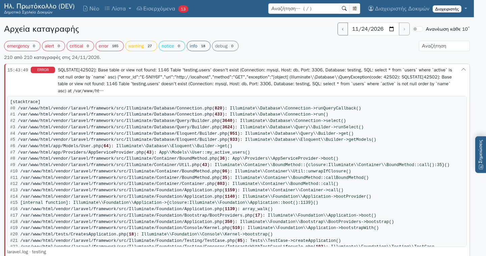

# R6e: the log viewer

| | |
|---|---|
| Status | ✅ Done |
| Branch | `task/R6e-log-viewer` |

## What was asked (owner, 2026-11-23)
See the application's log (Laravel's) inside the application, like the Console of macOS: the entries of a day with
their level in colour, a click for the details, filters and search.

## What changed
- **Διαχείριση → Αρχεία καταγραφής** (`/logs`, administrators only; the page and its actions refuse anyone else).
- **One row per entry:** time, level in colour (errors red, warnings yellow, information blue, debug grey; a coloured
  edge on errors and warnings), the message. **A click** opens its details: the stack trace marked up (frame number,
  file, **line**, call) and the context, scrollable; a second click closes it.
- **Levels** as pills with how many of each there are that day (more than one may be chosen); **search** in the
  messages and details (case and accents do not matter), the matches marked.
- **A day at a time:** ‹ › go to the previous / next day that has entries, or pick one in the calendar; **pages** of 100
  within a day; **Ανανέωση κάθε 10″** while following what happens.
- **Safe:** only the application's own files in `storage/logs` are read (`laravel.log` and `laravel-YYYY-MM-DD.log`);
  nothing from the browser is ever a file name or a path (only a date); every message is escaped (a `<script>` in a
  log line is shown as text).
- **Big files:** each day's file is read directly; an old single `laravel.log` is split by each entry's date: its days
  are found once (byte ranges per day, kept and extended while the file only grows) and a day is read by jumping to
  its part. Here a 57 MB `laravel.log` (≈400,000 lines) is indexed in 0.13 s once, then a day opens in about 10 ms.
  A day larger than 8 MB shows its newest part and says so.
- **One file per day (recommended):** with `LOG_CHANNEL=daily` (and `LOG_DAILY_DAYS` for how many days to keep) the
  log is written one file per day. This goes into the final deployment guide (no change on the current server now).

## How verified
- PHPUnit `LogViewerTest` (4): only the application's files (`other.log`, `.gz` ignored); a single file split by day,
  merged with that day's daily file, newest first; an entry's level, channel, message and details; a day that is not a
  date reads nothing; a growing file (the added part read), a day over the limit (its newest part, said so);
  administrators only; the page: first day, ‹ ›, level filter with counts, search with marks, `<script>` escaped,
  details marked up and closed again, a day with nothing. `ModernLayoutTest`: the menu item. Route snapshot: `/logs`
  under the administrators' guard. Full suite: green.
- Browser (`logs.spec.js`): on the dev stack's own log, the level filter, the search marks, details on a click, the
  previous day, and a writer is turned away.

## Owner actions
None now. In the deployment guide: `LOG_CHANNEL=daily`. To try it: step 73 in [OWNER-TODO.md](../../OWNER-TODO.md).
