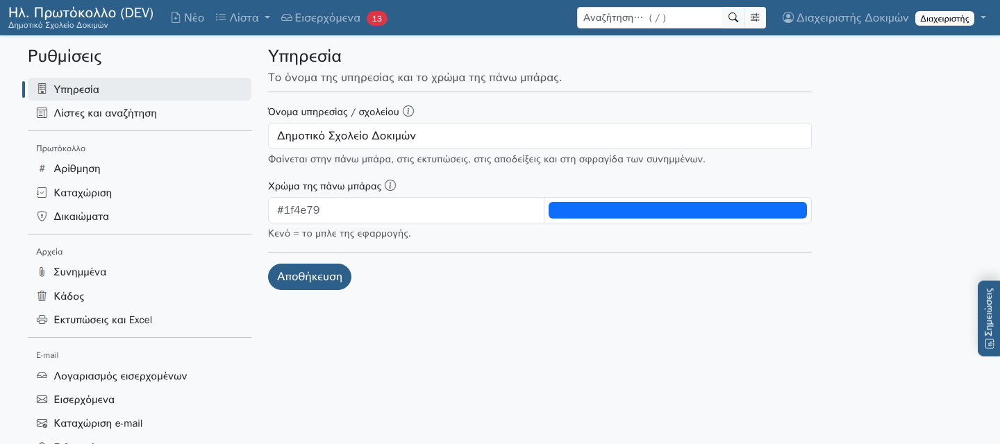
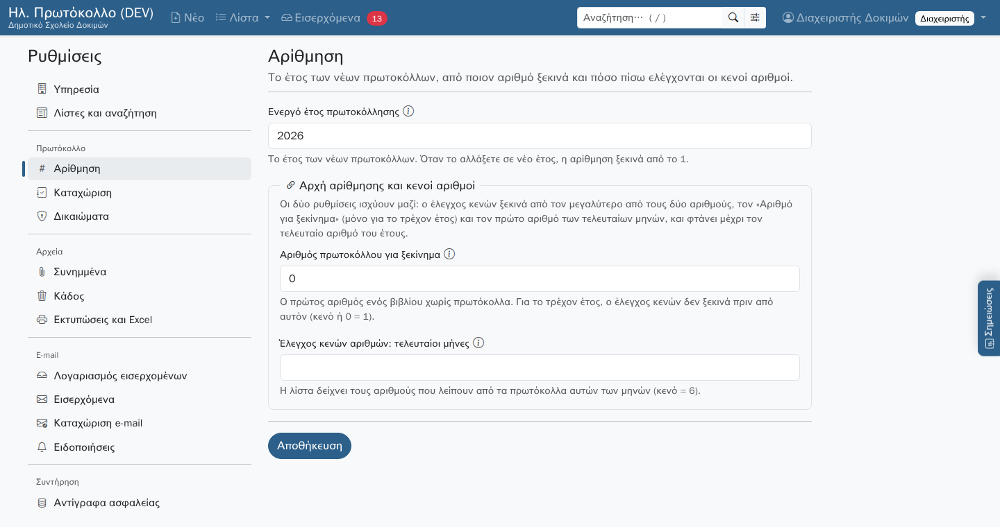
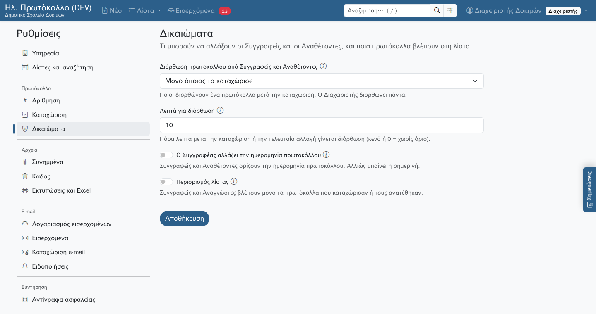
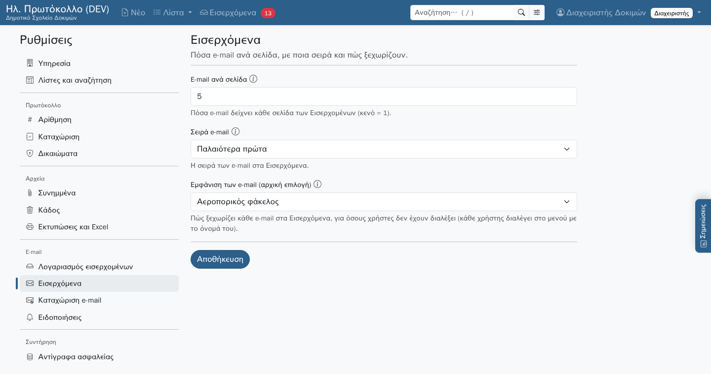
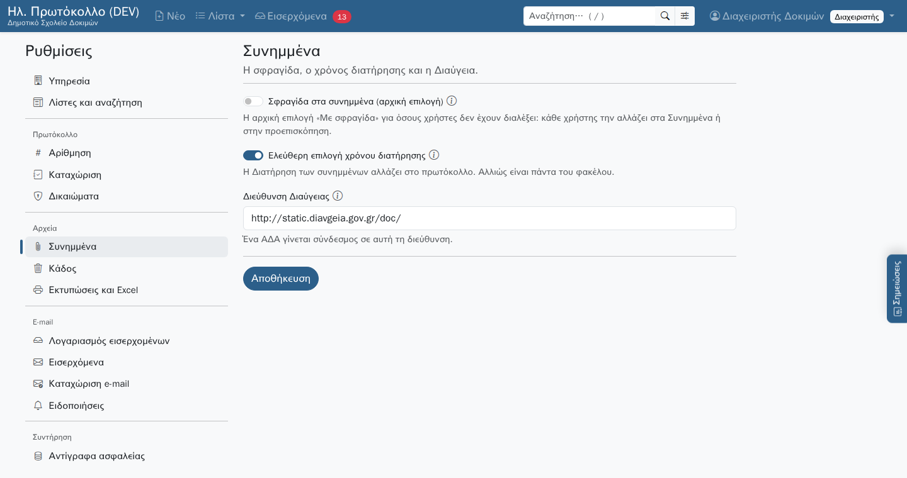
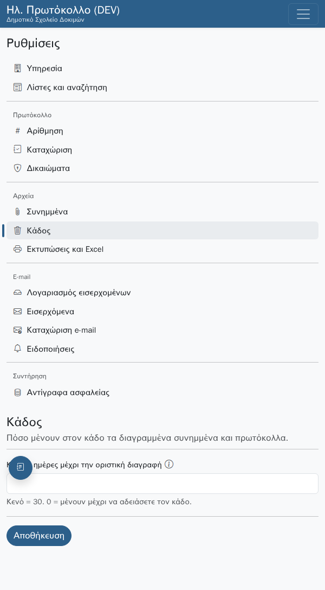

# R6f: Ρυθμίσεις organised like GitHub's settings

| | |
|---|---|
| Status | ✅ Done (approved by the owner on 2026-11-25 11:35) |
| Branch | `task/R6f-settings-sections` |

## What was asked (owner, 2026-11-25)
The settings screen is becoming bloated. Use GitHub's settings as the model and regroup the settings as suitable.
Show a rendered preview first, and decide before it is merged.

## What changed
- **A menu on the left, one section on the right**, as on GitHub. The menu has 13 short sections; the first two have
  no heading, the rest are under four headings:

  | Heading | Section | Settings |
  |---|---|---|
  | — | Υπηρεσία | name of the office, colour of the top bar |
  | — | Λίστες και αναζήτηση | rows per page, refresh every … minutes, search results per page |
  | Πρωτόκολλο | Αρίθμηση | year in use; the starting number and the missing-numbers check (still framed together) |
  | | Καταχώριση | checks on save, protocol without subject, related numbers on both protocols |
  | | Δικαιώματα | writers' corrections (and their minutes), writers change the date, list limited to own |
  | Αρχεία | Συνημμένα | stamp (initial choice), free choice of retention, Διαύγεια address |
  | | Κάδος | days in the trash |
  | | Εκτυπώσεις και Excel | rows for printing and Excel |
  | E-mail | Λογαριασμός εισερχομένων | the account, who registers e-mails, how many days back |
  | | Εισερχόμενα | e-mails per page, order, look (initial choice) |
  | | Καταχώριση e-mail | receipt to every sender, how the e-mail is kept |
  | | Ειδοποιήσεις | e-mail to whoever is assigned a protocol |
  | Συντήρηση | Αντίγραφα ασφαλείας | the mysqldump program |

- **Each section** has its title, one line on what it is for, its settings (each still with its line and its ⓘ),
  and **its own Αποθήκευση**, which saves and checks only that section.
- **Moving to another section** discards what was typed and not saved, as on GitHub.
- **The address says which section** (`/settings?section=inbox`), so a link or the browser's back button opens it.
- The menu stays in view while a long section scrolls. On narrow screens it is above the section.
- Nothing about the settings themselves changed: the same keys, values, checks and explanations.

## Review (Codex) and CI, fixed with tests
- A link to a setting (`/settings?setting=mysqldumpPath`) kept `setting=` in the address after another section was
  chosen, so a reload went back to that setting's section. Now `setting=` is used once and leaves the address, and a
  `section=` in the address wins. Tests: `SettingsPageTest` (failed before) and the R6f browser test (choose
  another section: no `setting=`, a reload stays there).
- The full browser suite: R2m's check that the top bar stays in view scrolled `/settings`, which is now one short
  section; it scrolls the folders page instead. R2i's narrow-page check now starts from the default narrow width (a
  width set with − / + on the demo made it fail).

## How verified
- PHPUnit `SettingsPageTest`:
  - every setting is in exactly one section, and each section shows only its own;
  - the menu with its headings in order, the first section open;
  - `?section=` and `?setting=` open the right section; an unknown one opens the first;
  - saving one section neither checks nor stores what was typed in another;
  - a wrong value stops its section and is shown at its field (for every kind checked before);
  - leaving a section drops what was typed and its errors;
  - every setting still has its ⓘ.

  The other settings tests (missing numbers, test mailbox, trash days) open their section first. Full suite: 683
  tests, green.
- Browser (`settings.spec.js`):
  - R6c and R6d's tests, on their sections;
  - R6f: the menu's headings; five sections opened from the menu (title, active item, address) and photographed;
  - a section saved on its own;
  - the narrow layout.

  The `setSetting` helper used by many tests now goes straight to the setting's section.

## Owner actions
None: approved from the screenshots above. To try it: *Διαχείριση → Ρυθμίσεις*.
