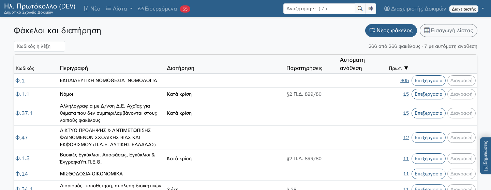
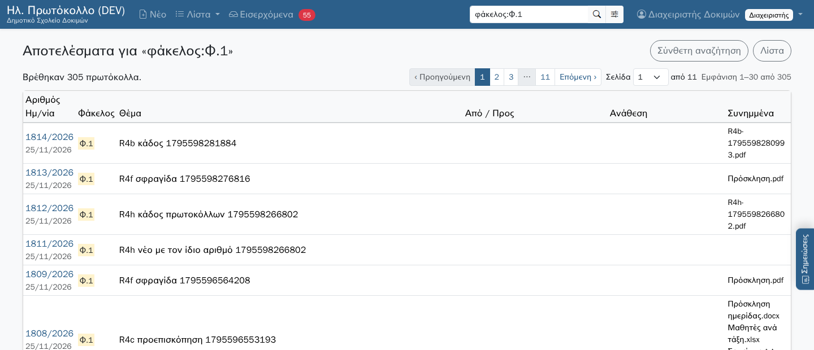

# R6g: folders sorted by code or use; a folder's code shows its protocols

| | |
|---|---|
| Status | ✅ Done |
| Branch | `task/R6g-folders-sort-and-search` |

## What was asked (owner, 2026-11-25)
On *Φάκελοι και διατήρηση* (`/keep`): the table sortable by *Κωδικός* and *Πρωτ.*, and the folders clickable, running
a simple search that shows all the protocols in that folder.

## What changed
- **Κωδικός** and **Πρωτ.** in the table's header are buttons, as in the protocol list:
  - *Κωδικός*: the folders' order (numbers as numbers: Φ.2 before Φ.10), pressed again the other way;
  - *Πρωτ.*: the most used folders first, pressed again the least used first.

  ▲ / ▼ shows which; the choice is in the address (`/keep?sort=count&dir=desc`).
- **Every folder's code** is a link. It opens the top bar's search *φάκελος:Φ.1*: the results only, the protocols of
  that folder (also for a folder with none: it says so). The count in *Πρωτ.* leads there too, and an unused folder
  now shows 0.
- Before, the count opened *Σύνθετη αναζήτηση* with the folder filled in but nothing searched.

## How verified
- PHPUnit `FolderAdminTest::test_the_table_sorts_by_code_or_count_and_each_code_searches_its_protocols`:
  - three folders with 1, 3 and 0 protocols;
  - the order by code (and reversed) and by count (desc first, then asc), with the header's arrow;
  - an unknown column is ignored; the address keeps the sort;
  - each code links to its search, and that search finds the folder's protocols only.

  Full suite: 684 tests, green.
- Browser (`folders.spec.js`, R6g):
  - *Πρωτ.* ▼ (counts falling), ▲ (rising);
  - *Κωδικός* ▲ and ▼ (exactly reversed);
  - the most used folder's code → the results page, with its protocols.

## Owner actions
None. To try it: step 85 in [OWNER-TODO.md](../../OWNER-TODO.md).
