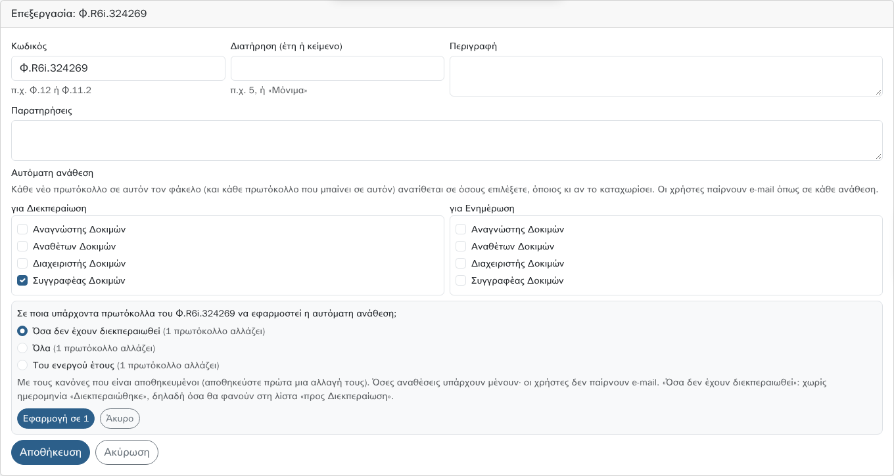

# R6i: a folder's automatic assignment applied to the protocols already in it

| | |
|---|---|
| Status | ✅ Done |
| Branch | `task/R6i-folder-rules-to-existing` |

## What was asked (owner, 2026-11-25)
«Φ12 already has 606 protocols. I set a user for Διεκπεραίωση on it. Does this mean the existing protocols are assigned
to that user too? If not, please add this option.» Answers to my questions:
- **which protocols:** asked each time, in the app;
- **e-mail:** none;
- only the administrator changes folders and their assignments.

## The answer
**No.** A folder's automatic assignment (R1d) is applied when a protocol is **saved**: a new protocol in that folder,
or one moved into it. The protocols already in the folder are not touched by it.

## What changed
- In the folder's form (*Επεξεργασία*), under *Αυτόματη ανάθεση*, a folder with saved rules and with protocols has
  **«Εφαρμογή και στα N υπάρχοντα πρωτόκολλα του φακέλου…»**. It asks:
  - **Όσα δεν έχουν διεκπεραιωθεί** (chosen at first): those without a *Διεκπεραιώθηκε* date, i.e. the ones that
    will show in the user's list *προς Διεκπεραίωση*;
  - **Όλα**;
  - **Του ενεργού έτους** (Ρυθμίσεις → Αρίθμηση).

  Each choice says how many protocols it changes; *Εφαρμογή σε N* applies it.
- It adds the **saved** rules, as on save: assignments already there stay, a user is added only once, and
  διεκπεραίωση takes the place of ενημέρωση for the same user. Inactive users are skipped; other folders are not
  touched. **No e-mails** are sent; a message says how many protocols changed. Applying again changes nothing more.
- Only administrators (the page's other changes are already theirs alone).

## Review (Codex), fixed with a test
The protocols' assignments were read in batches of 200 and then changed one by one. An assignment someone else made in
between (another administrator, an assigner) could have been undone. Now each protocol is locked and its assignments
are read again right before the rule is added, so such a change is kept. Test: in
`test_the_rules_are_applied_to_existing_protocols_as_chosen`, an assignment added just after the batch was read stays.
It failed before.

Also fixed on the way: `SearchTest::test_limited_writers_only_find_their_own_or_assigned_protocols` failed now and then.
It checked that «Ξένο» (another user's subject) is not on the page, but the page lists the users, and the random name
«Σόλων Ξένος» contains it. The subject is now one no name can contain. It was not a leak.

## How verified
- PHPUnit `FolderAdminTest::test_the_rules_are_applied_to_existing_protocols_as_chosen`, five protocols (open this
  year; completed; open last year; already hers; hers only to be informed):
  - the counts per choice: 3 / 4 / 3;
  - the form's button and question;
  - «not completed» → the open ones assigned, the «informed» one upgraded to διεκπεραίωση, the completed one left;
  - no e-mail sent or queued;
  - «all» then adds the completed one, and again changes nothing;
  - an unknown choice does nothing; another folder is untouched; «year» for a second rule;
  - assigner, writer and reader are refused both actions.

  Full suite: 687 tests, green.
- Browser (`folders.spec.js`, R6i):
  - a new folder and a protocol in it, then a rule for Συγγραφέας Δοκιμών (the protocol is not assigned by it);
  - *Εφαρμογή και στο 1 υπάρχον πρωτόκολλο…*: the question (1 changes), *Εφαρμογή*, the message «χωρίς e-mail»;
  - the protocol now has the user for Διεκπεραίωση.

## Owner actions
Apply it to Φ12 when you want: step 87 in [OWNER-TODO.md](../../OWNER-TODO.md).
