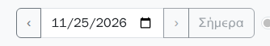

# R6j: «Σήμερα» on the log viewer

| | |
|---|---|
| Status | ✅ Done |
| Branch | `task/R6j-logs-today` |

## What was asked (owner, 2026-11-25)
On *Αρχεία καταγραφής*, the day's calendar should have a Today button.

## What changed
- The calendar is the browser's own: it can only be cleared, and a page cannot add buttons to it. So **Σήμερα** sits
  right after the day (‹ day › Σήμερα), as the app's other date fields have it. It shows today's entries, or says
  there are none yet; while today is shown it is greyed.
- The calendar now also lets you pick today when it has no entries yet (its last day was the newest day with entries).

## How verified
- PHPUnit `LogViewerTest::test_today_button`, on 2026-11-25:
  - opens on the newest day with entries;
  - *Σήμερα* → 25/11, page 1, «Καμία καταγραφή», the button greyed;
  - the calendar's last day is today;
  - ‹ goes back to the newest day with entries.

  Log viewer tests: 6, green; full suite green.
- Browser (`logs.spec.js`, R6j): another day, then *Σήμερα* → today's date in the field, the button greyed.

## Owner actions
None. To try it: step 94 in [OWNER-TODO.md](../../OWNER-TODO.md).
