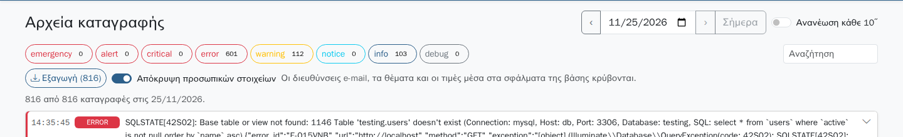
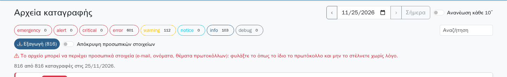

# R6k: export the log, with personal data masked

| | |
|---|---|
| Status | ✅ Done |
| Branch | `task/R6k-logs-export` |

## What was asked (owner, 2026-11-25)
On *Αρχεία καταγραφής*, the ability to export the log entries for downloading. «Is it possible that the log file
contains personal or sensitive information?» Your choice: a switch to mask them, on by default.

## Can the log hold personal data? Yes
The log is not meant to hold personal data, but some entries do:
- **a failed e-mail** is logged with its **recipient's address** and its **subject** (often a protocol's subject, with
  names);
- **a database error** carries **the whole query with its values**: a protocol's subject, a sender's name or address,
  a file's name;
- **other errors** carry their message (mail server and file errors can name addresses and files) and the **id of the
  user** logged in;
- **stack traces** can carry such values too, depending on a PHP setting of the server.

So a full export is a document with personal data (GDPR), to be kept like the protocol itself.

## What changed
- **Εξαγωγή (N)** downloads **the entries of the day shown, as filtered** (levels, search; every page, not only the one
  on screen), oldest first, in the log's own form (`log-2026-11-25.txt`).
- **Απόκρυψη προσωπικών στοιχείων** is **on** by default. It replaces:
  - e-mail addresses with `***@domain` (the domain stays: it says which mail server);
  - the values of a failed e-mail's fields (recipient, subject, sender, name…) with `…`;
  - every quoted value inside a database error's query with `'…'`.

  What a developer needs stays: times, levels, the errors themselves, the user's id, files and lines of the code.
- **Off**: the full text (`log-…-full.txt`), and a red warning says it may hold personal data and should be kept safe.
- Administrators only, as the page.

## Review (Codex), fixed with a test
A database value on several lines (Περίληψη, Παρατηρήσεις keep their line breaks) was masked only up to its first line,
so a name on the next line stayed in the «masked» file. Now every quoted value after `SQL:` is masked across lines (also
with a brace or a quote inside it), up to the error's context. Each entry is masked on its own, so nothing runs into the
next one. Test: `test_personal_data_is_masked` with a three-line value (name, phone), a brace and a quote; it failed
before.

## How verified
- PHPUnit `LogViewerTest`:
  - `test_personal_data_is_masked`: the real form of a failed e-mail line, a database error (values out; `userId`
    and the file and line kept), an address in a mail server's answer, a stack line left as it is.
  - `test_export_of_the_day_masked_or_full`: a day's three entries exported oldest first, masked, exactly; then only
    the errors, in full, with the warning shown.

  Full suite green.
- Browser (`logs.spec.js`, R6k):
  - *Εξαγωγή* → a file `log-<day>.txt` in the log's form, every address in it «***@…»;
  - switch off → the warning, and `log-<day>-full.txt`.

## Owner actions
None. To try it: step 95 in [OWNER-TODO.md](../../OWNER-TODO.md).
