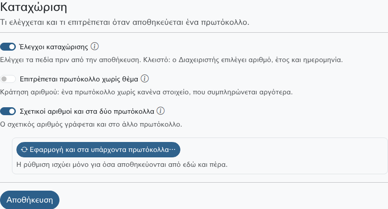
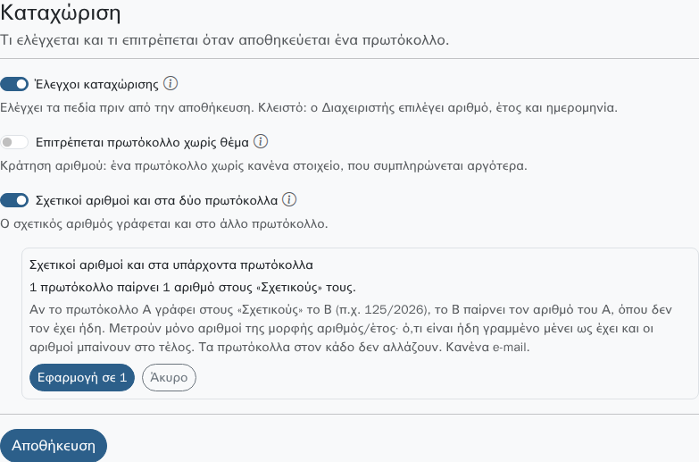

# R6l: «Σχετικοί αριθμοί και στα δύο πρωτόκολλα» for existing protocols, and its guide

| | |
|---|---|
| Status | ✅ Done |
| Branch | `task/R6l-related-numbers-existing` |

## What was asked (owner, 2026-11-26)
«If I turn this on, does it affect also existing protocols, or it only applies for the future ones?» The answer was
no: the setting works when a protocol is saved. Then: «add the option for existing protocols and create the relevant
documentation for administrators and LLMs that may modify its functionality in the future».

## What changed
- Under the setting (Ρυθμίσεις → Καταχώριση), while it is saved **on**, there is now **«Εφαρμογή και στα υπάρχοντα
  πρωτόκολλα…»**. It first says how many protocols would get how many numbers, and in how many not all of them fit
  (255 characters). **Εφαρμογή σε N** applies it.
- What it does: if protocol A names B in its *Σχετικοί*, B gets A's number, where it does not have it already.
  - Only *number/year* numbers count.
  - The text already there stays as it is; the numbers are added at its end.
  - The protocol's last-change date is kept. No e-mail.
  - Running it again changes nothing.
  - Administrators only.
- The save rule itself is unchanged. It moved, as it was, from `ProtocolWriter` into the new
  `App\Services\Protocols\RelatedNumbers`, next to the new code. It had no test before; it has one now.
- **[docs/RELATED-NUMBERS.md](../RELATED-NUMBERS.md)**: the guide.
  - For administrators: the save rule with an example, and what the new button changes.
  - For developers and AI assistants: where the code is, the rules it keeps (each checked by a test), and what to
    watch for before changing it.
- `CLAUDE.md` points to such feature guides, to be updated in the same PR as the feature.

### A choice I made: back-links only
A save also copies the *other* numbers of the saved protocol to each related one (the old application's rule).
Applying that to every existing protocol would spread numbers through chains of references (A→B, C→B gives A↔C …)
and would change more each time it is run. So the button adds only the back-link: predictable, and idempotent. The
guide explains the difference.

## How verified
- PHPUnit `RelatedNumbersTest`:
  - `test_the_numbers_in_a_text`: separators, a leading zero, words and bare numbers skipped.
  - `test_on_save_the_other_protocol_gets_this_one_and_the_others`: the save rule. Setting off: nothing; on: both
    related protocols get the saved one and the siblings.
  - `test_existing_references_are_made_mutual_once`:
    - a mutual pair is left alone;
    - a text that is not a number is kept, with the numbers after it;
    - `;` and `0005/2025` are read;
    - a missing protocol and a self-reference are skipped;
    - a field with no room is counted as left out;
    - another year is handled;
    - `updated_at` is kept;
    - the plan equals the result;
    - a second run changes nothing.
  - `test_administrators_apply_it_from_the_settings_while_the_setting_is_on`:
    - no box, and no apply, while the setting is off;
    - the box, the count, the apply, the message, then «Κανένα πρωτόκολλο δεν χρειάζεται αλλαγή»;
    - other roles are refused.

  Full suite: 698 tests, green.
- Browser (`settings.spec.js`, R6l):
  - with the setting off, B names A and A stays without it;
  - no box while off;
  - on: the button, the question with its counts, *Εφαρμογή*, the message;
  - A's form then shows B as a related number.

## Owner actions
None needed. To try it: step 98 in [OWNER-TODO.md](../../OWNER-TODO.md). On real data, take a backup first: there is
no undo.
