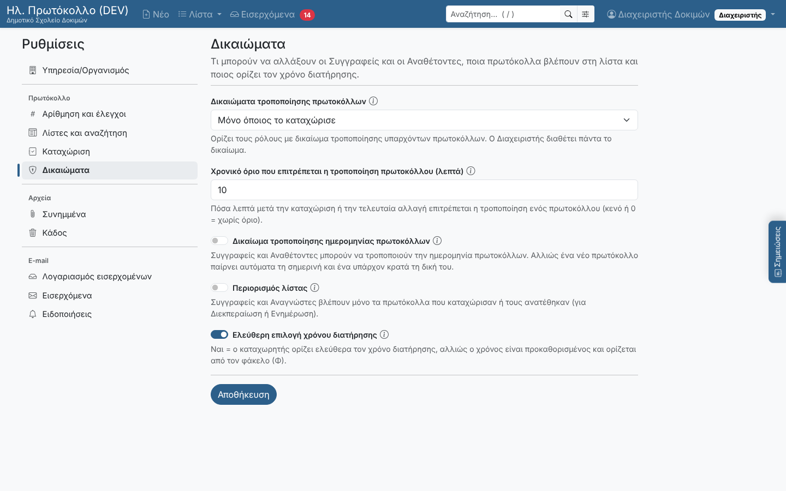
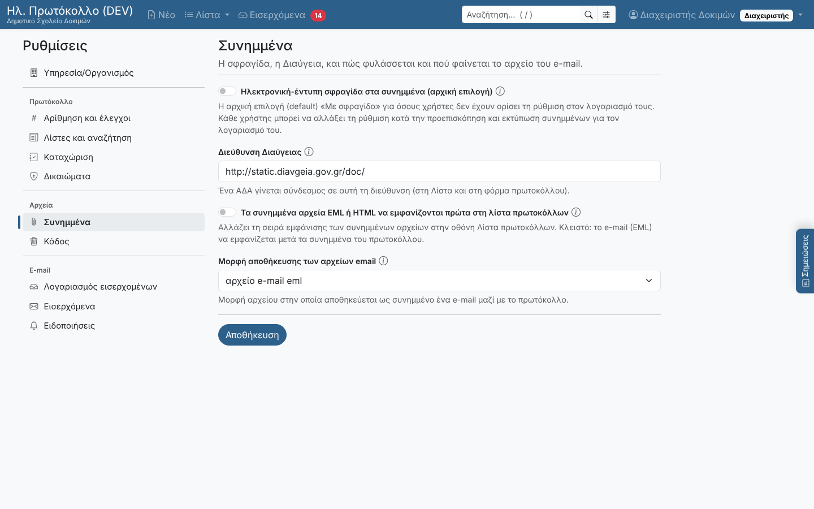
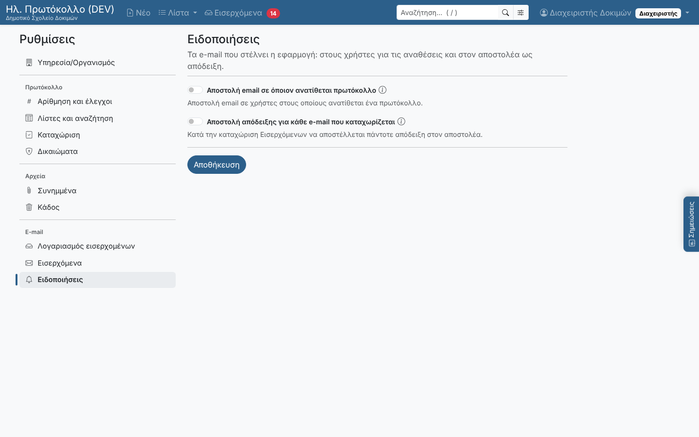
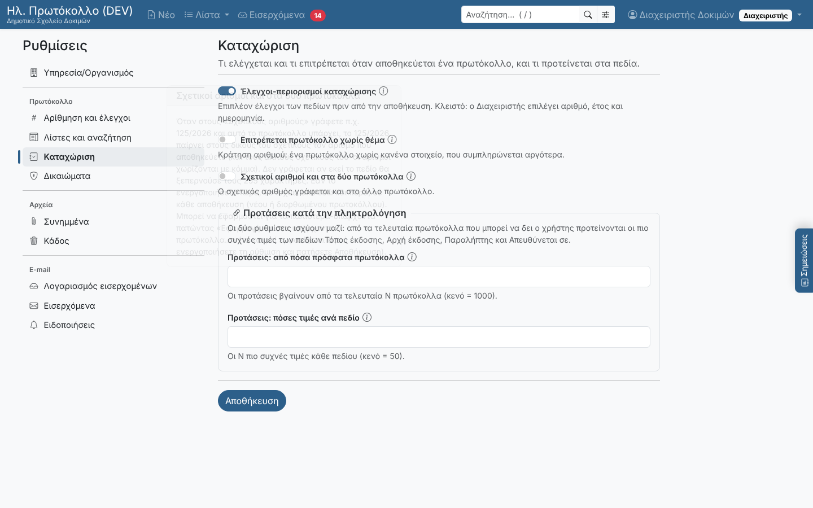

# R6m: Ρυθμίσεις as planned by the owner (settings planner)

| | |
|---|---|
| Status | ✅ Done |
| Branch | `claude/festive-goldberg-jqwts1` |

## What was asked (owner, 2026-11-27)
The owner went through every setting of `/settings` in an interactive copy of the page (the «Σχεδιαστής ρυθμίσεων»
artifact: drag settings between sections, edit labels, the line under each field and the ⓘ text, remove settings) and
saved a plan. Then: «apply it». Also asked in the same conversation:
- remove *Συντήρηση*; «Διαδρομή του mysqldump» becomes an environment variable of the Docker set-up;
- *Εκτυπώσεις και Excel* is not needed any more;
- keep *Ειδοποιήσεις* and remove *Χειρισμός e-mail* (the former *Καταχώριση e-mail*): its settings move to *Ειδοποιήσεις*.

## What changed
**The menu** (`App\Support\SettingsCatalog::SECTIONS`):

| Group | Section | Settings, in order |
|---|---|---|
| — | **Υπηρεσία/Οργανισμός** (was *Υπηρεσία*) | Όνομα υπηρεσίας · Χρώμα της πάνω μπάρας |
| Πρωτόκολλο | **Αρίθμηση και έλεγχοι** (was *Αρίθμηση*) | Ενεργό έτος · ▢ Αριθμός για ξεκίνημα + Έλεγχος κενών |
| Πρωτόκολλο | Λίστες και αναζήτηση (**moved** from the untitled group) | Αυτόματη ανανέωση · Πρωτόκολλα ανά σελίδα · Αποτελέσματα αναζήτησης ανά σελίδα |
| Πρωτόκολλο | Καταχώριση | Έλεγχοι-περιορισμοί · Χωρίς θέμα · Σχετικοί αριθμοί |
| Πρωτόκολλο | Δικαιώματα | Τροποποίηση · Χρονικό όριο · Ημερομηνία · Περιορισμός λίστας · **Χρόνος διατήρησης** (from *Συνημμένα*) |
| Αρχεία | Συνημμένα | Σφραγίδα · Διαύγεια · Σειρά του e-mail · **Μορφή αποθήκευσης e-mail** (from *Καταχώριση e-mail*) |
| Αρχεία | Κάδος | Αυτόματη εκκαθάριση |
| E-mail | Λογαριασμός εισερχομένων | Λογαριασμός · Χρήστες με δικαίωμα |
| E-mail | Εισερχόμενα | **Τελευταίες Ν ημέρες** (from *Λογαριασμός*) · Ανά σελίδα · Ταξινόμηση · Διακόσμηση |
| E-mail | Ειδοποιήσεις | Ανάθεση · **Απόδειξη** (from *Καταχώριση e-mail*) |

Gone: *Εκτυπώσεις και Excel*, *Καταχώριση e-mail*, *Συντήρηση → Αντίγραφα ασφαλείας*.

**Texts:** every label, line and ⓘ text is the owner's from the planner, word for word, except the spelling fixes below.

**The two settings that are no longer settings:**
- «Διαδρομή του mysqldump» → `MYSQLDUMP_PATH` in `.env` (config `database.mysqldump_path`; empty = `mysqldump` /
  `mariadb-dump` found on the PATH, which the Docker image has). `DatabaseBackup` still runs only those two programs.
- «Μέγιστες γραμμές εκτύπωσης και Excel» → `PRINT_MAX_ROWS` in `.env` (config `app.print_max_rows`, default 5000).
- Both added to `.env.example`, `.env.real.example`, `.env.development.example`. Fresh installs no longer seed their
  rows. Rows already stored (the old server's) are left untouched and unused, as with the earlier hidden settings (R6d).

### Spelling fixes I made in the owner's texts (please check)
| Setting | Planner | Now |
|---|---|---|
| Έλεγχος κενών (ⓘ) | στην οθόνη**ς** για χρήστες | στην οθόνη για χρήστες |
| Αυτόματη ανανέωση (line) | Αλλ**ί**ως | Αλλιώς |
| Αποτελέσματα αναζήτησης (line) | Αναζήτησης**.** (κενό = 30). | Αναζήτησης (κενό = 30). |
| Αποτελέσματα αναζήτησης (ⓘ) | στο πλαισίου αναζήτησης | στο πλαίσιο αναζήτησης |
| Έλεγχοι-περιορισμοί (ⓘ) | συμπλήρω**ρ**ση | συμπλήρωση |
| Έλεγχοι-περιορισμοί (ⓘ) | καταχωρίζει έναν κενό πρωτόκολλο | καταχωρίζει έναν κενό **αριθμό πρωτοκόλλου** (it is a missing number from the list's «ΚΕΝΟ» rows) |
| Δικαιώματα τροποποίησης (line) | τροποποίησης**η** υπαρχόντων | τροποποίησης υπαρχόντων |
| Δικαιώματα τροποποίησης (ⓘ) | Οι Αναγνώστες δεν δύναται να έχουν | Οι Αναγνώστες δεν **μπορούν** να έχουν |
| Χρόνος διατήρησης (ⓘ) | Οχι | Όχι |
| Σφραγίδα (line) | … τους. κάθε χρήστης | … τους. **Κ**άθε χρήστης |
| Σφραγίδα (ⓘ) | Η ενλόγω · απενεργοποιήσει␣␣το | Η εν λόγω · απενεργοποιήσει το |
| Σειρά του e-mail (line) | στην οθόνη**ς** Λίστα | στην οθόνη Λίστα |
| Διακόσμηση (label) | Εισερχόμ**έ**νων | Εισερχομένων |
| Διακόσμηση (line) | διακόσμ**ι**ση | διακόσμηση |
| Διακόσμηση (ⓘ) | για τον λογαριασμό τ**ους** | για τον λογαριασμό του |
| Απόδειξη (ⓘ) | αποσταλλεί | αποσταλεί |

### Choices I made
- **Section descriptions** (the line under each section's title): the planner changed only *Υπηρεσία/Οργανισμός*'s.
  Four others no longer matched their settings after the moves, so I adjusted them:
  *Δικαιώματα* (+ «ποιος ορίζει τον χρόνο διατήρησης»), *Συνημμένα* (the e-mail file instead of the retention),
  *Λογαριασμός εισερχομένων* (without «πόσο πίσω φαίνονται»), *Εισερχόμενα* (+ «Πόσο πίσω φαίνονται»),
  *Ειδοποιήσεις* (+ the receipt to the sender).
- **«Μορφή αποθήκευσης των αρχείων email»:** the planner gave its options as `html=σελίδα html`. The stored value
  for html is empty (`''`), so I kept the values and took only the new labels; nothing stored changes.
- **The ⓘ may now be shorter than the line under the field** (*Αριθμός πρωτοκόλλων ανά σελίδα*): the R6d test that
  required a longer ⓘ now requires only that every setting has one.

## Questions for the owner
1. Three ⓘ texts still name «Έλεγχοι καταχώρισης» (Ενεργό έτος, Χωρίς θέμα, Ημερομηνία), but its label is now
   «Έλεγχοι-περιορισμοί καταχώρισης». Rename them too?
2. *Χρήστες με δικαίωμα καταχώρισης email* (ⓘ): «απαιτείται να συμπληρωθεί και τουλάχιστον ένας χρήστης με δικαιώματα
   Διαχειριστή». Nothing checks this when saving: an administrator not in the list simply does not see the Inbox. Keep
   the wording, or should saving refuse a list without an administrator?

## How it was verified
- PHPUnit: `SettingsPageTest::test_sections_follow_the_owners_plan` (sections, groups, order, moved settings, the
  removed ones gone from the page with their stored rows kept, `PRINT_MAX_ROWS`); the R6f / R6d tests updated to the
  new menu; `BackupTest` with `MYSQLDUMP_PATH`; `PrintTest` with `PRINT_MAX_ROWS`.
- Browser (`e2e/tests/settings.spec.js`, «settings follow the owner's plan (R6m)»): the menu in order, the settings of
  four sections in order, an ⓘ in the owner's words, the removed settings not on the page. Screenshots above.

## Owner actions
- Try it: step 116 in OWNER-TODO.
- Deployment: the old server's `mysqldumpPath` (`c:\xampp\…`) is not used any more; the Docker image finds
  `mysqldump` itself. Set `MYSQLDUMP_PATH` / `PRINT_MAX_ROWS` in `.env` only if you need other values.
