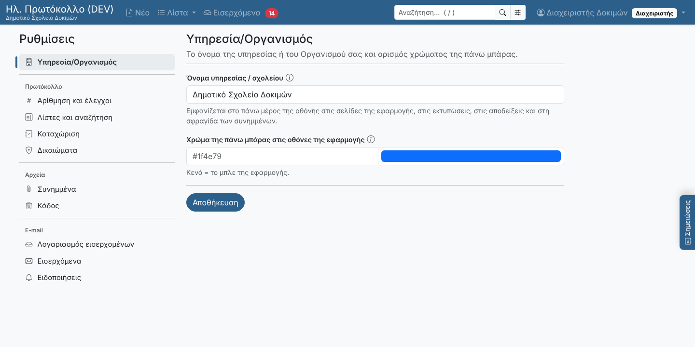

# R6m: Ρυθμίσεις as planned by the owner (settings planner)

| | |
|---|---|
| Status | ✅ Done |
| Branch | `claude/festive-goldberg-jqwts1` |

## What was asked (owner, 2026-11-27)
The owner went through every setting of `/settings` in an interactive copy of the page (the «Σχεδιαστής ρυθμίσεων»
artifact: drag settings between sections, edit labels, the line under each field and the ⓘ text, remove settings) and
saved a plan. Then: «apply it». Also asked in the same conversation:
- remove *Συντήρηση*; «Διαδρομή του mysqldump» becomes an environment variable of the Docker set-up;
- *Εκτυπώσεις και Excel* is not needed any more;
- keep *Ειδοποιήσεις* and remove *Χειρισμός e-mail* (the former *Καταχώριση e-mail*): its settings move to *Ειδοποιήσεις*.

## What changed
**The menu** (`App\Support\SettingsCatalog::SECTIONS`):

| Group | Section | Settings, in order |
|---|---|---|
| — | **Υπηρεσία/Οργανισμός** (was *Υπηρεσία*) | Όνομα υπηρεσίας · Χρώμα της πάνω μπάρας |
| Πρωτόκολλο | **Αρίθμηση και έλεγχοι** (was *Αρίθμηση*) | Ενεργό έτος · ▢ Αριθμός για ξεκίνημα + Έλεγχος κενών |
| Πρωτόκολλο | Λίστες και αναζήτηση (**moved** from the untitled group) | Αυτόματη ανανέωση · Πρωτόκολλα ανά σελίδα · Αποτελέσματα αναζήτησης ανά σελίδα |
| Πρωτόκολλο | Καταχώριση | Έλεγχοι-περιορισμοί · Χωρίς θέμα · Σχετικοί αριθμοί |
| Πρωτόκολλο | Δικαιώματα | Τροποποίηση · Χρονικό όριο · Ημερομηνία · Περιορισμός λίστας · **Χρόνος διατήρησης** (from *Συνημμένα*) |
| Αρχεία | Συνημμένα | Σφραγίδα · Διαύγεια · Σειρά του e-mail · **Μορφή αποθήκευσης e-mail** (from *Καταχώριση e-mail*) |
| Αρχεία | Κάδος | Αυτόματη εκκαθάριση |
| E-mail | Λογαριασμός εισερχομένων | Λογαριασμός · Χρήστες με δικαίωμα |
| E-mail | Εισερχόμενα | **Τελευταίες Ν ημέρες** (from *Λογαριασμός*) · Ανά σελίδα · Ταξινόμηση · Διακόσμηση |
| E-mail | Ειδοποιήσεις | Ανάθεση · **Απόδειξη** (from *Καταχώριση e-mail*) |

Gone: *Εκτυπώσεις και Excel*, *Καταχώριση e-mail*, *Συντήρηση → Αντίγραφα ασφαλείας*.

**Texts:** every label, line and ⓘ text is the owner's from the planner, word for word, except the spelling fixes below.

**The two settings that are no longer settings:**
- «Διαδρομή του mysqldump» → `MYSQLDUMP_PATH` in `.env` (config `database.mysqldump_path`; empty = `mysqldump` /
  `mariadb-dump` found on the PATH, which the Docker image has). `DatabaseBackup` still runs only those two programs.
- «Μέγιστες γραμμές εκτύπωσης και Excel» → `PRINT_MAX_ROWS` in `.env` (config `app.print_max_rows`, default 5000).
- Both added to `.env.example`, `.env.real.example`, `.env.development.example`. Fresh installs no longer seed their
  rows. Rows already stored (the old server's) are left untouched and unused, as with the earlier hidden settings (R6d).

### Spelling fixes I made in the owner's texts (please check)
| Setting | Planner | Now |
|---|---|---|
| Έλεγχος κενών (ⓘ) | στην οθόνη**ς** για χρήστες | στην οθόνη για χρήστες |
| Αυτόματη ανανέωση (line) | Αλλ**ί**ως | Αλλιώς |
| Αποτελέσματα αναζήτησης (line) | Αναζήτησης**.** (κενό = 30). | Αναζήτησης (κενό = 30). |
| Αποτελέσματα αναζήτησης (ⓘ) | στο πλαισίου αναζήτησης | στο πλαίσιο αναζήτησης |
| Έλεγχοι-περιορισμοί (ⓘ) | συμπλήρω**ρ**ση | συμπλήρωση |
| Έλεγχοι-περιορισμοί (ⓘ) | καταχωρίζει έναν κενό πρωτόκολλο | καταχωρίζει έναν κενό **αριθμό πρωτοκόλλου** (it is a missing number from the list's «ΚΕΝΟ» rows) |
| Δικαιώματα τροποποίησης (line) | τροποποίησης**η** υπαρχόντων | τροποποίησης υπαρχόντων |
| Δικαιώματα τροποποίησης (ⓘ) | Οι Αναγνώστες δεν δύναται να έχουν | Οι Αναγνώστες δεν **μπορούν** να έχουν |
| Χρόνος διατήρησης (ⓘ) | Οχι | Όχι |
| Σφραγίδα (line) | … τους. κάθε χρήστης | … τους. **Κ**άθε χρήστης |
| Σφραγίδα (ⓘ) | Η ενλόγω · απενεργοποιήσει␣␣το | Η εν λόγω · απενεργοποιήσει το |
| Σειρά του e-mail (line) | στην οθόνη**ς** Λίστα | στην οθόνη Λίστα |
| Διακόσμηση (label) | Εισερχόμ**έ**νων | Εισερχομένων |
| Διακόσμηση (line) | διακόσμ**ι**ση | διακόσμηση |
| Διακόσμηση (ⓘ) | για τον λογαριασμό τ**ους** | για τον λογαριασμό του |
| Απόδειξη (ⓘ) | αποσταλλεί | αποσταλεί |

### Choices I made
- **Section descriptions** (the line under each section's title): the planner changed only *Υπηρεσία/Οργανισμός*'s.
  Four others no longer matched their settings after the moves, so I adjusted them:
  *Δικαιώματα* (+ «ποιος ορίζει τον χρόνο διατήρησης»), *Συνημμένα* (the e-mail file instead of the retention),
  *Λογαριασμός εισερχομένων* (without «πόσο πίσω φαίνονται»), *Εισερχόμενα* (+ «Πόσο πίσω φαίνονται»),
  *Ειδοποιήσεις* (+ the receipt to the sender).
- **«Μορφή αποθήκευσης των αρχείων email»:** the planner gave its options as `html=σελίδα html`. The stored value
  for html is empty (`''`), so I kept the values and took only the new labels; nothing stored changes.
- **The ⓘ may now be shorter than the line under the field** (*Αριθμός πρωτοκόλλων ανά σελίδα*): the R6d test that
  required a longer ⓘ now requires only that every setting has one.

## Owner's answers and second round (2026-11-27)
- «Έλεγχοι καταχώρισης» in three ⓘ texts: **keep** (no rename).
- **Administrators always have the Inbox**, listed in *Χρήστες με δικαίωμα καταχώρισης email* or not
  (`App\Support\InboxAccess`); the ⓘ says so instead of «απαιτείται … Διαχειριστή». Still no Inbox for anyone when
  *Λογαριασμός εισερχομένων* is empty.
- Spelling fixes above: **kept**.
- **The two retired rows say where they went:** migration `2026_11_27_000002_settings_moved_to_env` turns the
  `configs` value of `mysqldumpPath` / `maxRowsInXlsExport` into «Δεν χρησιμοποιείται πια: ορίζεται στο .env ως
  MYSQLDUMP_PATH / PRINT_MAX_ROWS (δείτε το .env.example).», with «Παλιά τιμή: …» at the end when there was one
  (a fresh installation gets the note too; `down()` puts the old value back).
- **Every setting checked against the code** (each read of each key followed). The result is the new guide
  **[docs/SETTINGS.md](../SETTINGS.md)**: per setting its values, what empty means, the fresh-installation value, who it
  affects, what it does, its limits and the settings it works with, plus everything in `configs` that is not on the
  page. It is the base for the administrator / user manual (Z04).
- **One setting did less than it said:** «Αποστολή απόδειξης για κάθε e-mail» only hid a button; a registration
  without a receipt was still possible. The server now always sends the receipt while it is on (`EmailInbox`,
  test `test_always_receipt_is_enforced_on_the_server`).
- **Texts corrected to say what the code does** (the code was right; the words were incomplete or wrong):

| Setting | Was | Now says |
|---|---|---|
| Ενεργό έτος (line) | a new year starts at 1 | … (a year that already has protocols continues from its highest number) |
| Ενεργό έτος (ⓘ) | «η συμπλήρωση του τρέχοντος έτους απαιτείται» | with the checks on and **another** year written here, no new protocol is saved, also from the Inbox (empty is fine) |
| Αριθμός για ξεκίνημα (line, ⓘ) | first number «ενός βιβλίου χωρίς πρωτόκολλα» | only when there is no protocol of **any** year; a new year always starts at 1 |
| Έλεγχοι-περιορισμοί (line, ⓘ) | «Ελέγχει τα πεδία» | «Επιπλέον έλεγχοι» (basic checks always run); + the done-date rule, no place needed for e-mails; the year «πρέπει να είναι» the current one |
| Χωρίς θέμα (ⓘ) | «εντελώς άδειο» | + «(συνημμένα επιτρέπονται)» |
| Σχετικοί αριθμοί (ⓘ) | gets «τον αριθμό που αποθηκεύετε»; «μόνο για νέα πρωτόκολλα» | + the other related numbers, comma-separated, the 255-character limit; applies to every save from now on, new **or edited** |
| Δικαιώματα τροποποίησης (ⓘ) | without a subject «όλοι» | «όλοι οι Συγγραφείς και Αναθέτοντες»; assigned readers only the done date |
| Ημερομηνία (line) | «Αλλιώς … η σημερινή» | a new protocol gets today's, an existing one keeps its own |
| Περιορισμός λίστας (line) | «τους ανατέθηκαν» | + «(για Διεκπεραίωση ή Ενημέρωση)» |
| Διαύγεια (line) | ΑΔΑ becomes a link | + «(στη Λίστα και στη φόρμα πρωτοκόλλου)» |
| Λογαριασμός εισερχομένων (line, ⓘ) | accounts «στο config/imap.php» | in `.env` (IMAP_…); empty hides the Inbox from administrators too; also the menu's count |
| Τελευταίες Ν ημέρες (ⓘ) | not yet registered | … nor marked «Αναγνωσμένο»; also the menu's count |
| Ταξινόμηση (line) | «Η σειρά» | the **starting** order; each user switches with ↑/↓ |
| Ανάθεση e-mail (ⓘ) | — | + each send is noted in *Παρατηρήσεις* |
| Απόδειξη (ⓘ) | the sender address «απαιτείται να συμπληρωθεί» | it is filled in automatically; only if none is found must it be typed |

## Questions for the owner
1. **Still read, but not on the page** (found by the check; never on the new page):
   - `timeZone` (Europe/Athens): the time zone of Inbox dates and of the e-mail's HTML copy. Put it on the page
     (e.g. *Υπηρεσία/Οργανισμός*), move it to `.env`, or leave it fixed?
   - `rowsToSearchGiaSimplirosi` / `rowsToShowGiaSimplirosi` (1000 / 10): how many protocols the field suggestions look
     through and show. Put them on the page, or leave them fixed?
   - `protocolArrowStep` was hidden by your decision of 2026-11-19 (R6d): only typed addresses use it. Unchanged.

## How it was verified
- PHPUnit: `SettingsPageTest::test_rows_of_settings_moved_to_env_say_where_they_went`, the administrator case in
  `test_inbox_users_are_whole_usernames`, `InboxTest::test_always_receipt_is_enforced_on_the_server`;
  `SettingsPageTest::test_sections_follow_the_owners_plan` (sections, groups, order, moved settings, the
  removed ones gone from the page with their stored rows kept, `PRINT_MAX_ROWS`); the R6f / R6d tests updated to the
  new menu; `BackupTest` with `MYSQLDUMP_PATH`; `PrintTest` with `PRINT_MAX_ROWS`.
- Browser (`e2e/tests/settings.spec.js`, «settings follow the owner's plan (R6m)»): the menu in order, the settings of
  four sections in order, an ⓘ in the owner's words, the removed settings not on the page. Screenshots above.

## Owner actions
- Try it: step 116 in OWNER-TODO.
- Deployment: the old server's `mysqldumpPath` (`c:\xampp\…`) is not used any more; the Docker image finds
  `mysqldump` itself. Set `MYSQLDUMP_PATH` / `PRINT_MAX_ROWS` in `.env` only if you need other values.
