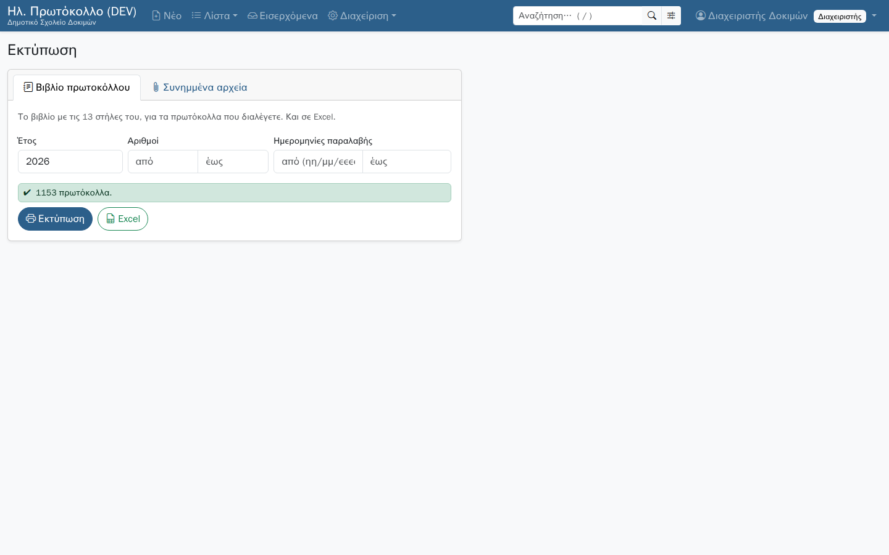
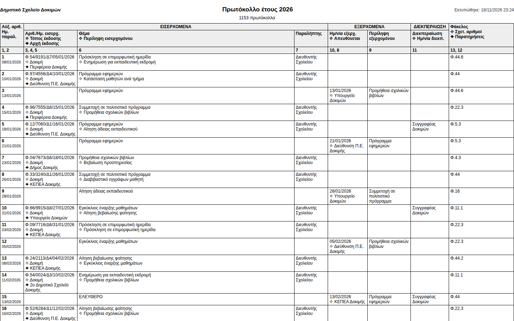
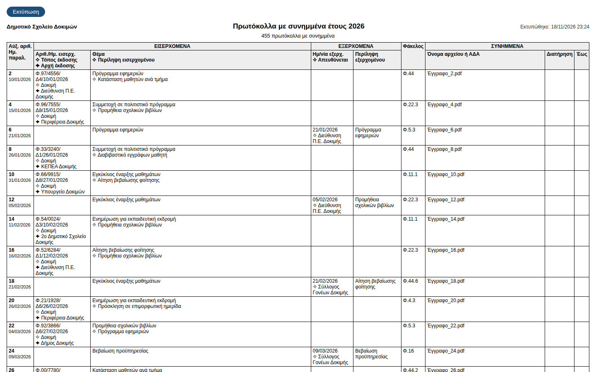
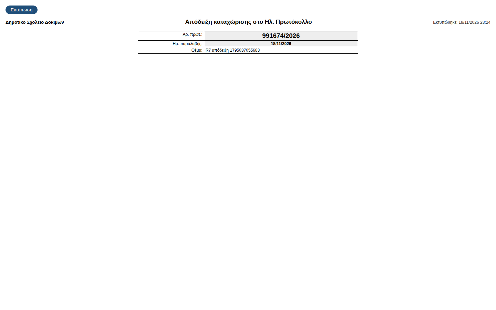

# R7: printing and export

| | |
|---|---|
| Status | ✅ Done |
| Branch | `task/R7-printing` (on top of R6c) |

## What was asked (BACKLOG R7)
"Protocol book print, receipts (+ email receipt), XLS export, attachment-clearance print: rebuilt on new layout,
output checked against legacy output."

## What was wrong (old printouts)
- **Handlers who had been deactivated** were printed as a number (their id) instead of their name.
- The book and the Excel file were **cut silently** at the export limit of *Ρυθμίσεις*: a year with more protocols
  looked complete.
- The attachments print gave **every file the first file's Διατήρηση and expiry**. It sorted by number only, so
  protocols of several years were mixed.
- Without any criteria the page went back without a word. The Excel file's name had the month where the minutes
  should be.
- A range over several years printed numbers without their year.
- The legacy JSON endpoint for the e-mail receipt (`POST /receiptToEmail`) was used only by the old form. The new form
  has its own button (R1b).

## What changed
- **Εκτύπωση** (`/print`, Livewire `App\Livewire\PrintPage`; `/printAttachments` opens it on the second tab):
  - two tabs: *Βιβλίο πρωτοκόλλου* and *Συνημμένα αρχεία*. The second is for writers and up, as before;
  - year (filled with the active year), numbers from/to, receipt dates from/to. Dates are typed as in every date
    field (`9/4/25` …);
  - **before printing it says how many protocols** match, and if they exceed the limit: *«Εκτυπώνονται τα πρώτα
    5000 … χωρίστε τους αριθμούς σε κομμάτια»*;
  - a wrong value is named (*«Από αριθμό «12α»»*), not guessed;
  - *Εκτύπωση* opens the printout in a new tab; *Excel* downloads the book.
- **Printouts** on the print layout of R6c: A4 landscape, header repeated on every page, rows not split, the
  institution, the title and the print time, and a print button that is not printed.
  - **Book** (`/printed`): the **same 8 columns and 13 numbered fields** as the old printout (✧ ✦ marks):
    - dates as dates;
    - handlers by name, also inactive ones;
    - the year beside the number when the range covers several years;
    - *«N πρωτόκολλα από M»* when the limit cuts it.
  - **Excel** (`/printed?…&target=xls`): the same columns and header rows as before. The file is named
    *«<υπηρεσία> - πρωτόκολλο έτους 2026 - YYYYMMDD-HHMMSS.xlsx»*.
  - **Attachments** (`/printedAttachments`): one row per file, each with **its own** Διατήρηση and expiry. The
    protocol's cells span its files; protocols are in year and number order.
  - **Receipt** (`/receipt/{id}`): A4 portrait with number/year, date, subject, and the incoming number/date if any.
- The addresses `/printed` and `/printedAttachments` answer GET (links from the new page) and POST (old bookmarks and
  forms). Their guards are the same: the list limit, and writers only for the attachments print.
- The range rules are in one place, `App\Services\Printing\PrintRange`. The controller is
  `App\Http\Controllers\PrintController`; the old methods in `ProtocolController` are removed.
- Removed: `POST /receiptToEmail`. Its tests now use the protocol form's *Αποστολή απόδειξης*: sent, and a clear error
  when the mail server is unreachable.
- No logged-in page uses the old layout any more. Only login, registration and password reset do, until Z01.

## How it was verified
- PHPUnit `tests/Feature/PrintTest.php` (8 tests):
  - the book with every column in order: dates, inactive handler by name, escaped notes, the numbered header;
  - number and date ranges, several years, the old POST, no criteria;
  - the limit is stated;
  - the Excel download (name and content);
  - the attachments print with each file's Διατήρηση and expiry, writers only;
  - the print page's count and messages, and the readers' tab;
  - the receipt;
  - the range rules.
- Unchanged and passing: `RobustnessTest` (wrong values are named on the printout and escaped) and
  `AccessControlTest` (printing respects the list limit).
- Route snapshot: the guards of `/printed` and `/printedAttachments` are unchanged. `POST /receiptToEmail` is removed.
- Browser `e2e/tests/printing.spec.js`:
  - the page counts;
  - the book opens with its 13 fields, and the print view hides the buttons;
  - Excel downloads with the new name;
  - a wrong number is named;
  - the attachments tab and print;
  - a receipt.
- Full PHPUnit: 508 green.

## Owner actions
- Print one month of your book (*Διαχείριση → Εκτύπωση πρωτοκόλλου*, dates from/to) and compare it with an old
  printout. Tell me if a column should look different.
