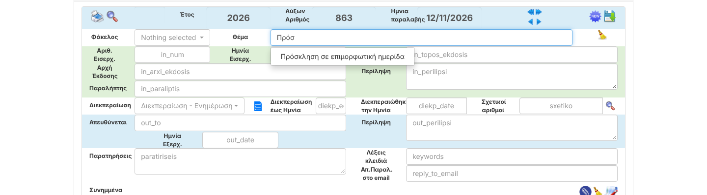

# S02 — Access control for protocols and attachments

| | |
|---|---|
| Status | ✅ Fixed |
| Branch | `task/S02-access-control` |
| Tests | 75 tests / 219 assertions pass (11 new access tests) |

## What was wrong
The rule "writers/readers only see their own or assigned protocols" (setting *limitProtocolAccessList*)
was copy-pasted into a few screens (open protocol, list, search, go-to-number) and missing everywhere else.
Several actions had no permission check at all.

| Hole | Who could exploit it | Found by |
|---|---|---|
| **Copy as new** (`/home/{id}/1`) cleared the id *before* the check → full content of any protocol | any writer/reader | code review (likely your report "simple user finds other protocols") |
| **Attachment download** — no check | any logged-in user, by changing the number in the link | F02 test (confirmed) |
| **Delete protocol** — any writer, any protocol, with its files permanently | writers | F02 test (confirmed) |
| **Receipt** page / send receipt — no check | writers | code review |
| **Save changes** — form hid the Save button, but the server accepted it (also ignored *allowWriterUpdateProtocol*) | writers | code review |
| **Delete attachment** — no check | writers | code review |
| **Assign** (ανάθεση) — any writer could reassign any protocol | writers | code review |
| **Mark as done** (διεκπεραιώθηκε) — even readers, on any protocol | readers | code review |
| **Print / print attachments** — limit applied only to the form page, not to the request that produces the output | writers/readers | code review |
| **Autocomplete** endpoint — returned values of *any* column of *any* protocol | any user | code review |

## Fix
One policy class, `app/Policies/ProtocolPolicy.php`, registered in `AuthServiceProvider`:

| Ability | Rule |
|---|---|
| `view` | everyone, except writers/readers under the limit setting: only created by them or assigned (d or e) |
| `update` | not readers; must `view`; writers/assigners follow *allowWriterUpdateProtocol* (0 none · 1 own · 2 all) |
| `delete` (protocol) | administrators only — the same people who see the delete button |
| `assign` | administrators and assigners — the same people who see the assignment control |
| `complete` (mark done) | administrators, assigners, the user assigned for διεκπεραίωση, or the creator |

Applied to: open/copy, save, delete, delete attachment, download, receipt, send receipt, assign, mark done,
print + print attachments (POST endpoints), autocomplete (allowed fields only, visible protocols only).
Hidden protocols return **404** (their existence isn't revealed); forbidden actions return **403**.

### Also fixed: autocomplete was broken
The forms call `/getValues/{field}/…?term=…`, but only `/getValues/{term}/{field}/…` was routed → 404, so
suggestions never appeared (verified on the current master). The missing route was added.

## Evidence — tests
`tests/Feature/AccessControlTest.php` (limit ON, a writer, one foreign and one assigned protocol):
copy-as-new 404 / 200 · receipt 404 / 200 · update hidden → 403 and unchanged · update follows setting 0/1/2 ·
attachment delete → 403 · assign: writer 403, assigner allowed · mark done: reader 403, assignee OK ·
print endpoints redirect · autocomplete only visible + known fields · autocomplete URL of the forms works ·
admins / unlimited users keep full access.

The F02 tests `known_vulnerability_download…` and `known_vulnerability_writer_deletes…` now fail with the fix
and were replaced by `download_respects_access_limits` and `writer_cannot_delete_protocols`.

## Not in this task (tracked)
- Time window of *allowWriterUpdateProtocolTimeInMinutes* is still enforced by the form only → R1a.
- Saving a protocol overwrites its creator (`user_id`) with the last editor, which also changes who "owns" it → R1a.
- Autocomplete builds JavaScript with unescaped values (possible script injection from stored data) → S05.
- Assigning sends notification e-mails, which crash (500) → **B09** (the assignment itself is saved).
- Deletes still use GET links → S03.

## Behaviour change to be aware of
Writers can no longer delete protocols through a direct link (the button was already admin-only).
If writers need this, it is a one-line change in `ProtocolPolicy::delete`.
