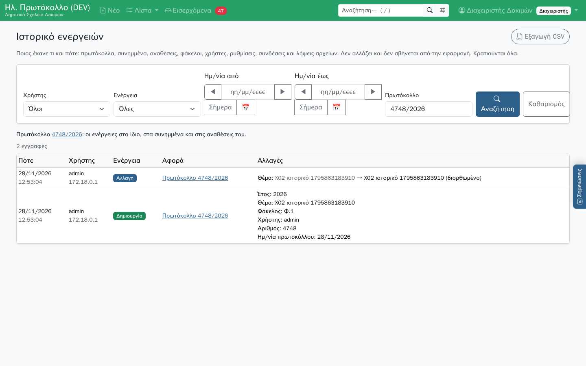
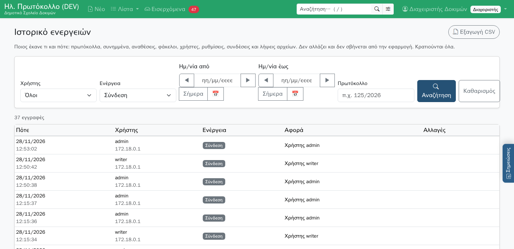

# X02: Ιστορικό ενεργειών: προβολή (audit log, viewing)

| | |
|---|---|
| Status | ✅ Done |
| Branch | `task/X02-audit-log-viewing` |
| Batch | 10 |

## What was asked (backlog, Phase 5)
«Admin page with filters (user, action, date, protocol), per-protocol "History" tab, CSV export; not editable from UI».

## What was there
X01 records who did what and when, but nothing showed it.

## What changed
- **New page *Διαχείριση → Ιστορικό ενεργειών*** (`/history`), for administrators only (it shows every user's actions
  and computers; others get 403):
  - newest first, 50 a page; each line: when, who and from which computer, the action (coloured), what it is about
    (linked to the protocol), and each change as *field: ~~old~~ → new*;
  - read as people write: a user's id as their user name, a role as its name, dates as 28/11/2026, yes / no; the
    labels of the protocol form and of the settings page, and per kind (a user's *Ονοματεπώνυμο* is not an
    attachment's *Όνομα αρχείου*);
  - filters *Χρήστης* (also «κανένας»: the automatic clean-ups and failed sign-ins), *Ενέργεια*, *Ημ/νία από / έως*
    (typed like every date), *Πρωτόκολλο* (`125/2026`); kept in the address;
  - **Εξαγωγή CSV**: everything filtered, all pages, values whole, for Excel (UTF-8 with BOM, «;»).
- **A protocol's history:** *Ιστορικό* in the protocol's actions on the right (administrators) opens the page for it:
  its changes, its attachments' and assignments', and what was written under that number when it was moved to the
  trash and deleted, or brought back with a new number. A link instead of a tab: the form keeps its sections as the
  owner arranged them (R1q).
- The log stays read-only: the page has no way to change or delete an entry (X01).
- [docs/AUDIT-LOG.md](../AUDIT-LOG.md): how to read and filter it; the code; how to add an action or a label.

## How it was verified
**PHPUnit** — `tests/Feature/AuditHistoryTest.php` (6): only administrators (others 403, guests to the login); newest
first, in Greek, with the changes, names for ids, dates and yes / no, a user's labels; filters by user, «κανένας»,
action, dates and protocol (with its attachment; a purged protocol by its number); wrong filters refused; the CSV
(BOM, header, whole values, only the filtered action); the form's *Ιστορικό* for administrators only.
`ModernLayoutTest` expects the new menu entry. Full suite: 768 tests, green.

**Browser** — `e2e/tests/history.spec.js` (2): an administrator creates and corrects a protocol → *Ιστορικό* from the
form shows «Αλλαγή · Θέμα: old → new» above «Δημιουργία» → the whole log filtered by *Σύνδεση* (address kept) → the
CSV downloads → the menu entry; a writer gets 403.

## Owner actions
- Try step 123 in [OWNER-TODO.md](../../OWNER-TODO.md).
