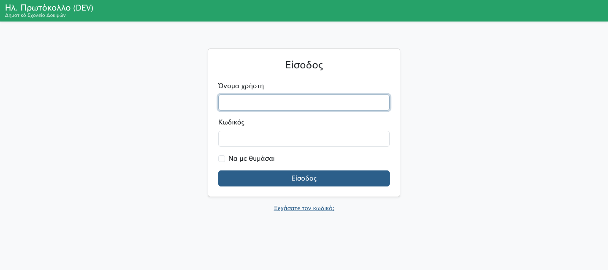
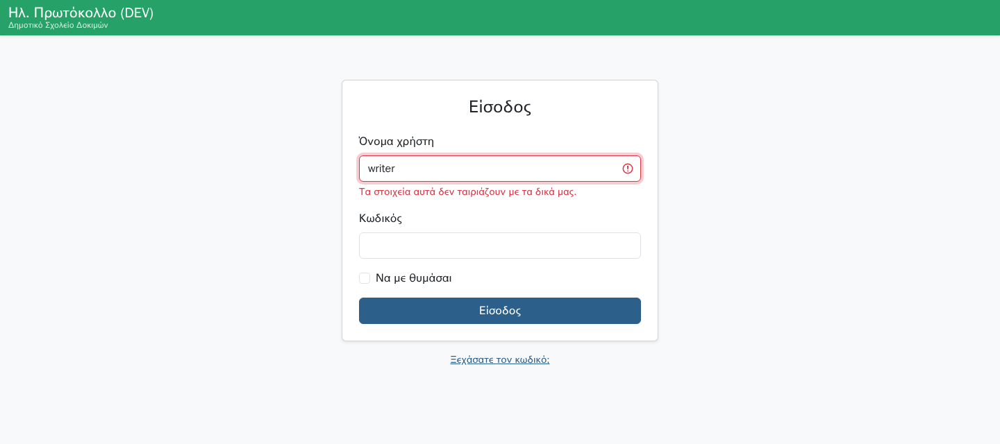
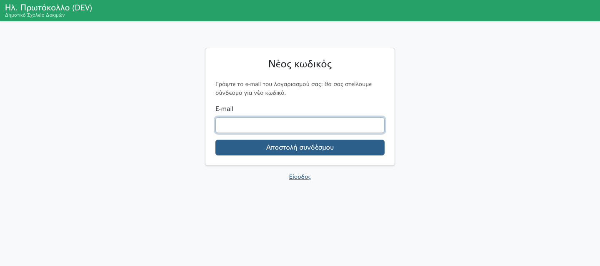

# Z01b: Old code: the sign-in pages in the new look; the old layout removed

| | |
|---|---|
| Status | ✅ Done |
| Branch | `task/Z01b-sign-in-pages` |
| Batch | 10 (Z01, second of four parts) |

## What was there
After R1–R7 only the four sign-in pages (*Είσοδος*, *Εγγραφή*, *Ανάκτηση Password* and the new-password page of the
e-mail link) still used the old layout `layouts/app.blade.php`: Bootstrap 3.3.7 (2016), `public/js/app.js` with jQuery
3.1.0, Vue **1**.0.26 and lodash 4.14, plus bootstrap-datepicker, bootstrap-select, Jasny file input, toastr and the
glyphicons font. Every one of these is end of life or has known XSS vulnerabilities, and the sign-in page is the one
page anyone on the network can open.

## What changed
- **The four pages on the new look** (`layouts.modern`, Bootstrap 5): a card in the middle under the top bar, which
  shows only the application's and the office's name until you sign in.
  - Greek labels: *Όνομα χρήστη*, *Κωδικός*, *Να με θυμάσαι*, *Ξεχάσατε τον κωδικό;*, *Ο κωδικός ξανά*.
  - A wrong password is shown under the field, in red, and the user name stays typed.
  - *Εγγραφή* appears only while registration is open (no administrator yet, S00), as before.
  - The new-password page fills in the user name of the e-mail's link.
  - Field names and ids are unchanged (`username`, `password`, `remember`, …): signing in and every browser test work
    as before. Shared by the four: `components/auth-card.blade.php`.
- **Removed:** `layouts/app.blade.php`; `public/js` (`app.js`, `bootstrap-datepicker.js`, `bootstrap-select.min.js`,
  `fileinput.js`, `toastr.min.js`); `public/css` (Bootstrap 3, jasny, datepicker, select, toastr); the glyphicons
  fonts; the view variables only the old layout read (`myActiveUsers`, `defaultImapEmail`, `allowedEmailUsers`,
  `wideListProtocol`). `ipiresiasName` stays: the e-mail templates write it.
- `docs/reports/VERSIONS.md`: those rows marked removed (and Vue 1, not 2). V02 updates the report fully.

**Not changed here:** the HTML copy of a registered e-mail (`viewEmail.blade.php`) still links Bootstrap 3's
stylesheet from an outside site (only a stylesheet, no script). Restyling it changes the copies saved from then on; it
goes with Z02's content-security rules, which forbid outside stylesheets. `laravel/ui` stays: its traits still run
the login and password controllers.

## How it was verified
**PHPUnit** — new `tests/Feature/SignInPagesTest.php` (5): each page on the new layout with none of the old files
or markup, its fields and labels; a wrong password shown under the field with the name kept; the *Εγγραφή* link only
while registration is open; the forgot / reset pages (token, user name filled in); the old layout and files gone. The
existing `Legacy/AuthTest` (12, signing in, registration rules) passes unchanged. Full suite green.

**Browser** — new `e2e/tests/sign-in.spec.js` (2): the page, a wrong password, then signing in; the forgotten-password
page. The whole browser suite passes: every spec signs in through the new page.

## Owner actions
- Try step 124 in [OWNER-TODO.md](../../OWNER-TODO.md).
